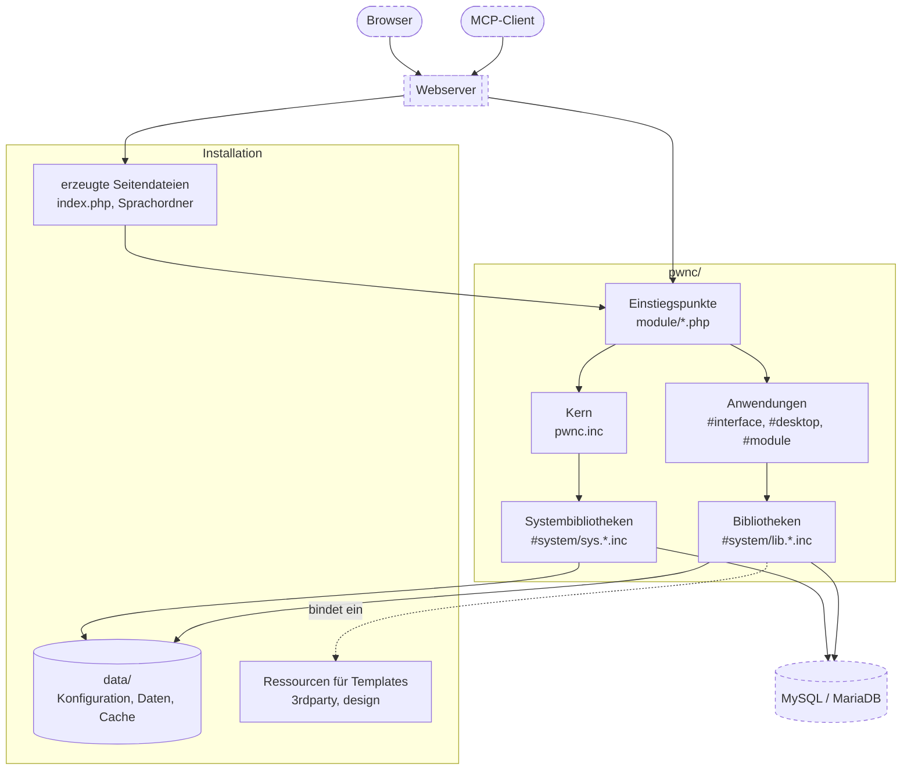
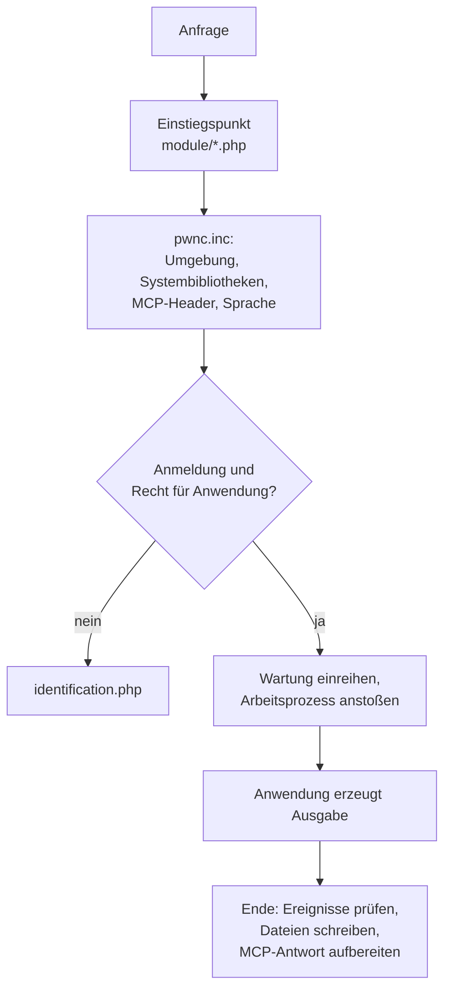
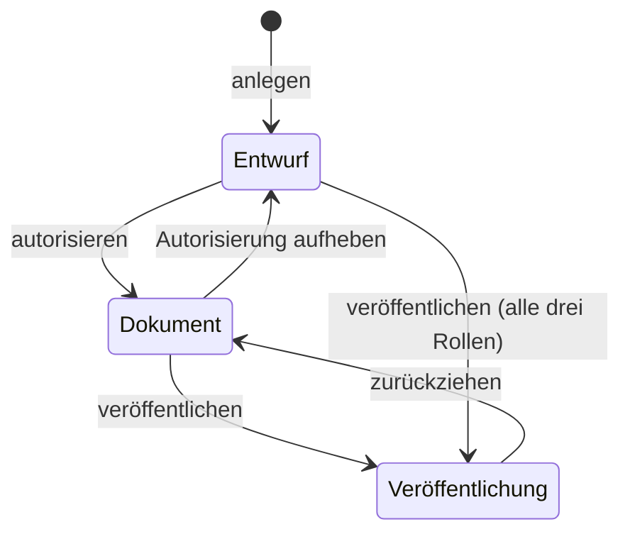
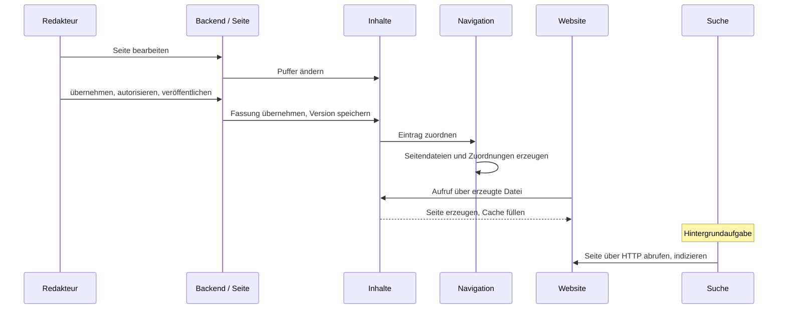

# Konzeptpapier: Aufbau der Plattform PWNC

Stand: Release 26.11.20 (Version 26.11.20.3). Grundlage: Quellcode.

---

## Zusammenfassung

PWNC ist eine PHP-Plattform, die in einer Installation eine Website mit Redaktionssystem, eine Verwaltungsoberfläche (Backend), einen Web-Desktop mit Messenger und E-Mail, Frontend-Anwendungen wie Blog, Forum und Suche sowie einen MCP-Server für KI-Agenten bündelt. Dieses Papier beschreibt die Komponenten und wie sie ineinandergreifen.

Der Ordner `pwnc/` enthält das System. Jede Anfrage beginnt mit derselben Kerndatei `pwnc/pwnc.inc`. Sie stellt die Laufzeitumgebung her, meldet den Benutzer an, prüft das Recht für die aufgerufene Anwendung und reiht Wartungsaufgaben ein. Anwendungen sind PHP-Dateien in `pwnc/module/`, Bibliotheken liegen in `pwnc/#system/`. Alles außerhalb von `pwnc/` gehört zur Installation: Daten, Konfiguration, erzeugte Seitendateien und Ressourcen für Templates. Eine Aktualisierung ersetzt nur `pwnc/`; was das Repository außerhalb enthält, ist eine Startkonfiguration (Abschnitt 9). Viele Entscheidungen im Aufbau zielen darauf, von den Gegebenheiten des Servers unabhängig zu sein, etwa von Umschreiberegeln, Cron, Cache-Servern oder Bibliotheken von Drittanbietern (Abschnitt 1).

Daten liegen zum Teil in Dateien unter `data/`, zum Teil in einer MySQL- oder MariaDB-Datenbank. Konfiguration, Benutzer, Navigation und Template-Verzeichnis sind Textdateien eines eigenen Formats (`.dat`). Inhalte, Blog, Forum, Kommentare, Profile, Suchindex, Protokolle, das Gedächtnis der Agenten und die Auswertung ihrer Arbeit liegen in Tabellen.

KI-Agenten sind in diesem Aufbau Benutzer wie Menschen. Ein Agent ist ein Konto, meldet sich mit einem Schlüssel an und bedient über das Model Context Protocol (MCP) dieselben Seiten und Formulare; die Rechte seines Kontos bestimmen, was er sieht und tun darf. Der Kern prüft bei jeder Anfrage, ob es eine MCP-Anfrage ist, jeder Endpunkt nimmt MCP-Anfragen an, und die Verwaltungsoberfläche kennzeichnet ihre Bereiche für Agenten. Benachrichtigungen, Ereignisse und Aufrufe richten sich an Agenten wie an Menschen. Konten mit hinterlegtem KI-Anbieter führt PWNC selbst aus (Plattform-Agenten). Wie das im Einzelnen abläuft, beschreibt das Konzeptpapier „PWNC als Multiagentensystem“; dieses Papier ordnet die Agenten ein (Abschnitt 8). Ohne KI-Anbieter fehlt nur die Ausführung von Plattform-Agenten: Website, Redaktion, Verwaltung, Desktop und der MCP-Zugang externer Agenten arbeiten unverändert.

---

## Inhalt

1. [Gesamtkonzept](#1-gesamtkonzept)
2. [Der Systemordner](#2-der-systemordner)
3. [Ablauf einer Anfrage](#3-ablauf-einer-anfrage)
4. [Grunddienste](#4-grunddienste)
   1. [Konten, Anmeldung und Rechte](#41-konten-anmeldung-und-rechte)
   2. [Datenhaltung](#42-datenhaltung)
   3. [Cache, Sperren und Markierungen](#43-cache-sperren-und-markierungen)
   4. [Hintergrundverarbeitung](#44-hintergrundverarbeitung)
   5. [Ereignisse und Benachrichtigungen](#45-ereignisse-und-benachrichtigungen)
   6. [Sprachen](#46-sprachen)
   7. [Protokollierung](#47-protokollierung)
   8. [Netzwerk und E-Mail](#48-netzwerk-und-e-mail)
   9. [Hilfsbibliotheken](#49-hilfsbibliotheken)
   10. [Browser-Seite](#410-browser-seite)
5. [Website](#5-website)
   1. [Navigation und erzeugte Dateien](#51-navigation-und-erzeugte-dateien)
   2. [Inhalte und Redaktionsablauf](#52-inhalte-und-redaktionsablauf)
   3. [Templates](#53-templates)
   4. [Auslieferung einer Seite](#54-auslieferung-einer-seite)
   5. [Bearbeitung in der Seite](#55-bearbeitung-in-der-seite)
   6. [Frontend-Anwendungen](#56-frontend-anwendungen)
   7. [Bilder, Medien, Downloads und Bausteine](#57-bilder-medien-downloads-und-bausteine)
   8. [Weitere Endpunkte](#58-weitere-endpunkte)
6. [Backend](#6-backend)
   1. [Rahmen](#61-rahmen)
   2. [Anwendungen](#62-anwendungen)
   3. [Suche](#63-suche)
   4. [Einrichtung, Aktualisierung und Sicherung](#64-einrichtung-aktualisierung-und-sicherung)
7. [Desktop](#7-desktop)
8. [KI-Agenten](#8-ki-agenten)
9. [Installation: Dateien außerhalb von `pwnc/`](#9-installation-dateien-außerhalb-von-pwnc)
10. [Zusammenspiel](#10-zusammenspiel)
11. [Einordnung gegenüber anderen Systemen](#11-einordnung-gegenüber-anderen-systemen)
12. [Grenzen](#12-grenzen)
13. [Rahmenbedingungen und Abgrenzung](#13-rahmenbedingungen-und-abgrenzung)

---

## 1. Gesamtkonzept

PWNC hat drei Oberflächen für Menschen und einen Zugang für Agenten:

- **Website (Frontend):** öffentliche oder geschützte Seiten, erzeugt aus Inhalten, Templates und Navigation. Frontend-Anwendungen wie Blog oder Forum sind in Seiten eingebettet. Wer eine Seite bearbeiten darf, bearbeitet sie in der Seite selbst.
- **Backend:** die Verwaltungsanwendungen unter `pwnc/module/interface.php`, etwa Redaktion, Navigation, Templates, Dateien, Datenbank, Benutzer, Agenten und Einrichtung.
- **Desktop:** ein Arbeitsbereich je Konto unter `pwnc/module/desktop.php` mit Notizen, Links, Terminen, Kontakten, Dateien, E-Mail-Konten und dem Messenger.
- **MCP:** der Endpunkt `pwnc/module/mcp.php`, über den Agenten dieselben Seiten und Formulare bedienen. Jeder andere Endpunkt nimmt MCP-Anfragen ebenfalls an.

Alle vier laufen über dieselbe Kerndatei, dieselbe Anmeldung und dieselben Rechte. Der Aufbau folgt einigen durchgehenden Entscheidungen:

**Unabhängigkeit von der Umgebung.** Viele Entscheidungen zielen darauf, dass PWNC nicht auf Einrichtungen angewiesen ist, die ein Server haben kann oder nicht. Seitenadressen sind Dateien statt Umschreiberegeln (5.1). Hintergrundarbeit läuft über Anfragen statt über Cron oder einen Dienst (4.4). Cache, Sperren und Markierungen arbeiten mit Dateien statt mit einem Cache-Server (4.3). Jede Datenbankverbindung stellt Zeichensatz, Zeitzone und SQL-Modus selbst ein, und Tabellen gleicht PWNC ohne Migrationswerkzeug an (4.2). Der Schutz vor Pfadangriffen liegt im Code statt in der Serverkonfiguration (4.2). Für Unicode gibt es eigene Tabellen, wenn mbstring fehlt (4.9). HTTP-Client, E-Mail-Versand und -Abruf, YAML-Parser, Captcha und Suche sind eigene Bibliotheken, und eine Paketverwaltung gibt es nicht (4.8, 4.9, 6.3, 13). Folge: Die Voraussetzungen beschränken sich auf PHP mit wenigen Erweiterungen, einen Webserver und MySQL oder MariaDB (13). Dafür pflegt PWNC Funktionen selbst, die andere Systeme aus Bibliotheken oder von der Serverumgebung beziehen.

**Ein Kern für jede Anfrage.** PWNC hat keinen zentralen Einstiegspunkt, der Anfragen verteilt (Front Controller), sondern mehrere Einstiegspunkte, die alle denselben Kern einbinden. Welche Anwendung läuft, ergibt sich aus dem Dateinamen des Einstiegspunkts. Anmeldung, Rechteprüfung, Ereignisprüfung und Hintergrundstart sind damit für jede Oberfläche dieselben (Abschnitt 3).

**Ein Rechtesystem für alle Konten.** Rechte sind hierarchische Bezeichner, die Konten und Gruppen gewährt oder entzogen werden. Der Zugang zu einer Anwendung, die Rollen darin und die Rechte an einzelnen Inhalten sind Bezeichner derselben Verwaltung. Gäste, Redakteure, registrierte Besucher und Agenten unterscheiden sich nur in ihren Rechten (4.1).

**Oberfläche vom Server.** Website, Backend und Desktop sind HTML-Seiten, die der Server erzeugt; JavaScript ergänzt sie. Was ein Benutzer tun kann, steht als Link oder Formular in der ausgelieferten Seite. Agenten nutzen dieselben Seiten, die Oberfläche ist zugleich ihre Schnittstelle (HATEOAS; Konzeptpapier „PWNC als Multiagentensystem“, Abschnitt 3).

**Anwendungen als Dateien.** Backend-, Desktop- und Frontend-Anwendungen werden über ihren Dateinamen gefunden und über ein gleichnamiges Recht freigegeben. Folge: Eine neue Anwendung ist eine Datei im passenden Ordner, eine Registrierung gibt es nicht; ein Verzeichnis der vorhandenen Anwendungen gibt es außer dem Dateisystem ebenfalls nicht.

**Adressen als Dateien.** Die Navigation schreibt für jede Seite und Sprache eine kleine PHP-Datei, deren Pfad die Adresse der Seite ist. So hängen die Seitenadressen nicht davon ab, ob der Webserver ein Umschreibesystem hat: Er findet jede Seitenadresse als Datei. Die Dateien sind ein Erzeugnis der Navigation und entstehen bei jeder Änderung neu (5.1).

**Bearbeiten und Ausliefern getrennt.** Jeder Inhalt hat eine ausgelieferte Fassung und eine Arbeitsfassung. Bearbeitet wird die Arbeitsfassung; ausgeliefert wird erst, was übernommen und veröffentlicht ist (5.2). Besucher sehen so keine halbfertigen Änderungen.

**Hintergrund ohne Dienst.** Wartung, Suche, Bildskalierung, Aktualisierung, ausgelöste Ereignisse und Agentenläufe sind Aufgaben in einer Dateiwarteschlange. Gewöhnliche Anfragen reihen sie ein und starten bei Bedarf einen Arbeitsprozess per HTTP-Anfrage an die eigene Installation (Pseudo-Cron, 4.4). Folge: Ein dauerhaft laufender Dienst ist nicht nötig. Die Hintergrundarbeit hängt an Anfragen; diese kommen von Besuchern, Agenten oder einem Cron-Job, der in festen Abständen eine Seite abruft.

**Dateien und Datenbank.** Konfiguration und Verzeichnisse liegen in Textdateien, die gleichzeitige Änderungen zusammenführen; umfangreiche und durchsuchte Daten liegen in Tabellen (4.2).

**System und Installation getrennt.** `pwnc/` enthält nur das System und wird bei einer Aktualisierung vollständig ersetzt. Daten, Konfiguration, erzeugte Dateien und Ressourcen der Templates liegen außerhalb (Abschnitt 9).

**Agenten als Benutzer.** Ein Agent ist ein Konto wie jedes andere; einen eigenen Objekttyp für Agenten gibt es nicht. Der Kern wertet MCP in jeder Anfrage aus (Abschnitt 3), das Backend kennzeichnet Bereiche seiner Seiten für Agenten (6.1), Benachrichtigungen, Ereignisse und Aufrufe können Plattform-Agenten starten (4.5), und Gedächtnis, Aufrufe und Skills nutzen Agenten über MCP (Abschnitt 8). Für die übrigen Teile der Plattform sind Agenten keine Voraussetzung: Ohne KI-Anbieter laufen keine Plattform-Agenten, alles andere arbeitet unverändert.

Gestrichelt umrandet ist, was außerhalb von PWNC liegt.

---

## 2. Der Systemordner

`pwnc/` enthält Kern, Bibliotheken, Anwendungen, die Texte der Oberfläche und Ressourcen für Agenten. Eine Aktualisierung ersetzt den Ordner vollständig (6.4).

Ordner mit dem Präfix `#` sind nicht für den Webzugriff bestimmt: Legt PWNC einen solchen Ordner an, schreibt es eine `.htaccess` hinein, die jeden Zugriff verweigert (`Require all denied`, für ältere Apache-Versionen `Deny from all`); bei `!` erlaubt sie zusätzlich die Ausführung als CGI (`Options +ExecCGI`). Ordner ohne Präfix werden ausgeliefert. So sind Konfiguration, Daten und Bibliotheken über das Web nicht abrufbar, auch wenn ihre Pfade bekannt sind. Die mitgelieferte `.htaccess` im Wurzelverzeichnis sperrt `#`-Ordner ein zweites Mal (Abschnitt 9); fehlt eine der beiden Regeln, etwa weil eine `.htaccess` gelöscht oder überschrieben wurde, greift die andere.

| Pfad | Inhalt |
|---|---|
| `pwnc.inc` | Kern: Initialisierung, Anmeldung, Anwendungs- und Rechteprüfung, URL-Erzeugung, Cache, Sperren, Hintergrundwarteschlange, Fehlerbehandlung, MCP-Vorverarbeitung |
| `#system/sys.*.inc` | Systembibliotheken, bei jeder Anfrage geladen: `data` (Dateiformat `.dat`), `map`, `mysql`, `log`, `permission`, `system` (Konfiguration), `trigger` (Ereignisse), `mcp` (MCP-Server), `utf8`, `common` (lädt `#system/common/*.inc`) |
| `#system/lib.*.inc` | Bibliotheken, bei Bedarf über `cms_load()` geladen |
| `#system/common/` | Grundfunktionen: Kodierung, Datum, Dateien, Hashes, Bildverarbeitung, Sprachwerte, Mathematik, Verschiedenes, MySQL-Schnittstelle, Dateisystemschutz, HTML-Bausteine, Zeichenketten, Text, URLs |
| `#system/utf8/` | erzeugte Unicode-Tabellen für `sys.utf8.inc` |
| `module/*.php` | Einstiegspunkte: `content`, `interface`, `desktop`, `mcp`, `daemon`, `chat`, `download`, `rss`, `sitemap`, `identification`, `check`, `security`, `http` |
| `module/#interface/` | Backend-Anwendungen `ifc.*.inc` und die Datei `order` für ihre Reihenfolge |
| `module/#desktop/` | Desktop-Anwendungen `desktop.*.inc` |
| `module/#module/` | Frontend-Anwendungen `mod.*.inc` |
| `#language/` | Texte der Oberfläche: Index `language.inc`, je Sprache eine Datei (`de.language.inc`, `en.language.inc`) |
| `#json/agent/` | Anbieter-Templates für Plattform-Agenten: Anthropic, OpenAI, Google, Microsoft, OpenRouter |
| `mcp/` | Ressourcen für Agenten: Plattformanleitung `resources/README.md`, mitgelieferte Skills `resources/SKILLS/`, Vorlage für das MCP-Bundle `#mcpb/` |
| `javascript/`, `stylesheet/` | Skripte und Stylesheets von Backend, Desktop und Bearbeitung in der Seite |
| `font/`, `image/`, `sound/` | Schriften; Symbole und Bilder der Oberfläche, darunter die Zeichen für Captchas; Töne für Chat und Desktop |
| `unicode/` | Unicode-Quelldaten, aus denen `#system/utf8/` erzeugt wird |
| `!bin/` | JPEG-Programm für Windows und Linux mit Quelltext; im Code von PWNC wird es nicht aufgerufen, die Bildverarbeitung nutzt GD |
| `mimetype` | Zuordnung von Dateiendungen zu Medientypen |
| `manifest.json`, `service-worker.js` | Web-App-Manifest und Service Worker für die Installation als App |
| `version.txt` | Versionsnummer, die die Aktualisierung mit dem öffentlichen Repository vergleicht |
| `index.php` | leitet auf den Desktop weiter |
| `blank.htm`, `favicon.svg`, `license.txt` | leere Seite für Rahmen, Symbol, Lizenz |
| `README.md`, `.htaccess` | Hinweis, dass der Ordner bei einer Aktualisierung ersetzt wird; `index.php` als Startdatei |

---

## 3. Ablauf einer Anfrage

Jede Anfrage durchläuft dieselben Schritte: den Einstieg über eine PHP-Datei, die Initialisierung im Kern, die Arbeit der Anwendung und Abschlussarbeiten am Ende. Zwischen zwei Anfragen läuft kein Prozess weiter; was über eine Anfrage hinaus gelten soll, steht in Cookies, im Datei-Cache oder in den Daten.

**Einstieg.** Jede Anfrage trifft eine PHP-Datei in `pwnc/module/`, entweder direkt oder über eine erzeugte Seitendatei, die `content.php` einbindet (5.1). Diese Datei bindet `pwnc.inc` ein. Der Name der Anwendung ist der Dateiname des Einstiegspunkts, etwa `content` oder `desktop`. Beim Backend wird die gewählte Anwendung angehängt: `interface.{name}`.

**Initialisierung** in `pwnc.inc`, in dieser Reihenfolge:

1. Aufrufe über die Kommandozeile werden abgewiesen. Geprüft werden PHP ab 8.3, MySQLi und PCRE mit UTF-8.
2. Mindestwerte für PHP-Grenzen werden angehoben, wo möglich: 600 Sekunden Laufzeit, 256 MB Speicher, 500 MB je Upload. Die Ausgabe wird gepuffert, ein Abbruch durch den Client beendet das Skript nicht (Schreibvorgänge und der Arbeitsprozess laufen weiter, wenn die Gegenseite die Verbindung trennt, 4.4), die Zeitzone ist zunächst UTC.
3. Die Fehlerbehandlung wird registriert (4.7).
4. Pfade und Adressen werden bestimmt. Liegt `data/#system/host.txt` vor und steht der angefragte Host nicht darin, endet die Anfrage mit 400; die Datei entsteht aus den kanonischen Adressen der Navigation (5.1). PWNC bildet seine absoluten Adressen aus dem angefragten Host, auch die Links in E-Mails wie der Passwort-Wiederherstellung; die Liste verhindert, dass ein gefälschter `Host`-Header fremde Adressen hineinbringt (Host-Header-Injection). Liegt `data/#system/trusted_proxies.txt` vor, übernimmt PWNC Client-Adresse, Protokoll und Port aus den Proxy-Headern, wenn die Anfrage über dort eingetragene Proxys kam (einzelne Adressen oder Bereiche in CIDR-Schreibweise). Die Beschränkung auf eingetragene Proxys verhindert, dass ein Client mit selbst gesetzten Headern eine fremde IP-Adresse vortäuscht; an der IP-Adresse hängen Client-Kennung, Anmeldesperre und Protokoll.
5. Alle `sys.*.inc` werden geladen.
6. Zwei anonyme Kennungen des Clients werden gebildet (4.7).
7. MCP-Header werden ausgewertet. Trägt die Anfrage sie, prüft PWNC Herkunft (`Origin`), Schlüssel, Protokollversion und den Aufbau der JSON-RPC-Nachricht; bei `post` übernimmt es die Formulardaten des Werkzeugaufrufs als `$_POST` (8). Ein `Origin`-Header muss die eigene Adresse nennen, sonst endet die Anfrage mit 403; so können Skripte fremder Websites im Browser keine MCP-Anfragen an die Plattform stellen, auch nicht über DNS-Rebinding.
8. Die Sprache der Website wird bestimmt (4.6), die Absenderadresse für E-Mails festgelegt.
9. Anmeldung und Rechteprüfung für die Anwendung (4.1). Ohne Recht wird auf `identification.php` umgeleitet; eine Anfrage mit ungültigem Schlüssel endet mit 401.
10. Die Ereignisprüfung wird für das Ende der Anfrage registriert, außer im Arbeitsprozess (4.5).
11. MCP-Methoden außer `get` und `post` werden ausgeführt und beenden die Anfrage. Bei `get` und `post` merkt PWNC die Aufbereitung der Ausgabe für das Ende vor, und die Anfrage läuft weiter wie im Browser.
12. Anfragevariablen werden normalisiert (Zeilenumbrüche, ungültiges UTF-8) und als globale Variablen bereitgestellt.
13. HTTP-Header werden gesetzt: Gäste erhalten `Cache-Control: no-cache, must-revalidate`, der Browser muss also vor jeder Wiederverwendung nachfragen (Grundlage für 304 in 5.4); angemeldete Benutzer erhalten zusätzlich `no-store`. `no-store` hält Seiten mit persönlichen Inhalten aus Browser- und Proxy-Caches heraus. Dazu kommen `X-Content-Type-Options: nosniff`, damit der Browser eine Datei nicht anders deutet als mit ihrem Medientyp angegeben, etwa einen Upload als Skript, und `Referrer-Policy: strict-origin-when-cross-origin`, die fremden Seiten nur die Domain mitteilt, nicht die Adresse; so verlässt das CSRF-Token, das in Adressen steht (4.1), die Plattform nicht.
14. Wartungsaufgaben werden eingereiht und gegebenenfalls ein Arbeitsprozess gestartet (4.4).

Danach führt der Einstiegspunkt seine Arbeit aus.

**Ende.** Beim Beenden des Skripts laufen registrierte Funktionen: Ereignisprüfung, verzögerte Schreibvorgänge der `.dat`- und `.map`-Dateien (4.2), bei MCP die Aufbereitung der Antwort, und für berechtigte Benutzer die Ausgabe gesammelter Fehlermeldungen in die Browserkonsole.

**Zustand zwischen Anfragen.** PWNC nutzt keine PHP-Sitzungen. Die Anmeldung steht in Cookies (4.1). Anwendungszustand wie gewähltes Objekt oder geöffneter Ordner liegt im Datei-Cache unter einem Schlüssel aus Anwendung und Benutzer (4.3). Parameter, die in jedem Link einer Anwendung mitgeführt werden sollen, verwaltet `cms_param()`; `cms_url()` hängt sie an erzeugte Adressen an. Folge: Parallele Anfragen desselben Benutzers, etwa aus mehreren Fenstern oder von einem Agenten, warten nicht aufeinander; PHP-Sitzungen sperren ihre Sitzungsdatei für die Dauer jeder Anfrage.

---

## 4. Grunddienste

Die Grunddienste nutzen alle Anwendungen: Konten und Rechte, Datenhaltung, Cache und Sperren, Hintergrundverarbeitung, Ereignisse und Benachrichtigungen, Sprachen, Protokollierung, Netzwerk und Hilfsbibliotheken.

### 4.1 Konten, Anmeldung und Rechte

Wer PWNC nutzt, tritt als Konto auf: ein Mensch mit Passwort, ein Agent mit Schlüssel, ein Besucher ohne Anmeldung als Gast. Was ein Konto darf, ergibt sich aus Rechten, die am Konto und an seinen Gruppen stehen.

**Konten und Gruppen** stehen in `data/#system/permission.dat` (`sys.permission.inc`). Ein Konto hat Benutzername, Name, Passwort-Hash, Gruppen, gewährte und entzogene Rechte, E-Mail, Zeitzone, Sprache, Notiz, Ablaufdatum und Sperrkennzeichen, bei Agenten weitere Angaben (8). Eine Gruppe hat Name, Notiz, gewährte und entzogene Rechte und ein Sperrkennzeichen.

Fünf Konten legt PWNC selbst an oder hält sie in Ordnung: `admin` (immer Recht `*`, keine Gruppen, nie gesperrt), `anonymous` (Gast, ohne Passwort), `profile` (Rechtekonto für registrierte Besucher), `daemon` (Arbeitsprozess) und `trigger` (Absender von Ereignissen). `profile`, `daemon` und `trigger` erhalten ein zufälliges Passwort; mit eigenem Passwort meldet sich niemand bei ihnen an.

**Erweiterte Benutzer** sind Profile in der Tabelle `cms_profile` (5.6). Sie melden sich mit eigenem Benutzernamen und Passwort an und arbeiten mit den Rechten des Kontos, auf das ihr Profil verweist, bei Registrierungen `profile`.

**Anmeldung im Browser.** Die Anmeldung arbeitet als Challenge-Response-Verfahren: Das Anmeldeformular bildet einen Hash aus dem Passwort-Hash und einem Salz, das der Server für diesen Client bereithält, und sendet nur diesen Wert; ohne JavaScript sendet der Browser das Passwort, und der Server bildet den Wert. Mit JavaScript verlässt das Passwort den Browser also nicht. Das Salz ist an die Client-Kennung (4.7) gebunden und wechselt, wenn es 60 Minuten nicht verwendet wurde. Benutzername und Wert stehen danach in Cookies (`HttpOnly`, `SameSite=Strict`, bei https `Secure`), die mit dem Schließen des Browsers verfallen. `HttpOnly` entzieht sie Skripten in der Seite, `SameSite=Strict` hält den Browser davon ab, sie bei Anfragen von fremden Websites mitzusenden, und `Secure` beschränkt sie auf verschlüsselte Verbindungen. Folge: Eine Anmeldung gilt nur für denselben Client; sie endet nach 60 Minuten ohne Anfrage und wenn sich IP-Adresse oder Browser-Angaben ändern. Das schützt vor Session-Hijacking, der Übernahme einer Anmeldung durch Dritte: Ein abgegriffenes Anmelde-Cookie lässt sich von einem anderen Client aus nicht verwenden, und eine verlassene Anmeldung verfällt von selbst.

Das Passwort des Kontos `admin` wird für jedes Konto angenommen. Nach fünf fehlgeschlagenen Anmeldungen von einer IP-Adresse sind weitere Versuche 30 Minuten lang gesperrt; das bremst das systematische Durchprobieren von Passwörtern (Brute Force). Läuft das Ablaufdatum eines Kontos ab, wird es bei der nächsten Prüfung gesperrt. Die erste Anmeldung von `admin` führt zur Einrichtung, solange sie nicht abgeschlossen ist (6.4).

**CSRF-Schutz** (Synchronizer-Token-Verfahren). Der Schutz verhindert, dass eine fremde Website den Browser eines angemeldeten Benutzers Aktionen in PWNC ausführen lässt (Cross-Site Request Forgery): Der Browser sendet die Anmelde-Cookies bei jeder Anfrage mit, das Token kennt aber nur die Plattform. Bei der Anmeldung erzeugt PWNC ein zufälliges Token und legt es im Cache unter einem Schlüssel ab, der als Cookie beim Browser liegt. `cms_url()` setzt das Token als ersten Parameter in jede Adresse, die auf eine PHP-Datei derselben Domain zeigt; Adressen anderer Hosts und statischer Dateien erhalten es nicht, damit es nicht an Dritte gelangt. Jede Anfrage eines angemeldeten Benutzers muss das Token tragen, auch GET, weil in PWNC auch Links Aktionen auslösen, etwa Befehle der Bearbeitung in der Seite; sonst leitet PWNC auf `security.php` um und protokolliert den Vorgang. Ausgenommen sind die Anwendungen `identification`, `index`, `check`, `mcp` und `security`, Anfragen des Gasts, des Arbeitsprozesses und Anfragen mit Schlüssel. Diese Anwendungen werden vor der Anmeldung oder von außen aufgerufen; Gastanfragen haben keine Anmeldung, die sich missbrauchen ließe, und einen Schlüssel sendet der Browser nicht von selbst mit.

**Anmeldung mit Schlüssel.** Konten können einen Schlüssel erhalten; PWNC speichert nur seinen Hash (`data/#system/permission.token.dat`); wer die Datei liest, erfährt die Schlüssel nicht. Eine Anfrage mit `Authorization: Bearer <Schlüssel>` wird ohne Passwort und Token dem Konto zugeordnet. Einzelheiten stehen im Konzeptpapier „PWNC als Multiagentensystem“, Abschnitt 4.1.

**Anwesenheit.** Jede Anfrage eines angemeldeten Kontos im Browser markiert es für 15 Minuten als anwesend; Anfragen mit Schlüssel tun das nicht. Benachrichtigungen werten das aus (4.5).

**Rechte** sind durch Punkte gegliederte Bezeichner, etwa `interface.content.publisher` oder `content.blog.reader.17`. Ein Recht mit der Endung `.*` oder `.operator` gilt für diesen Bezeichner und alle darunter, `*` und `operator` für alle. Ein entzogenes Recht geht einem gewährten vor; eine Festlegung am Konto geht den Gruppen vor. So lässt sich ein einzelnes Konto von einem Gruppenrecht ausnehmen oder ihm einzeln mehr erlauben. Gruppen entsprechen damit den Rollen einer rollenbasierten Zugriffskontrolle (RBAC), ergänzt um Rechte am Konto selbst und um Entzüge, die Freigaben überstimmen. Ist das Gastkonto nicht gesperrt, gelten seine Rechte und die seiner Gruppen für alle, und ein Entzug am Konto hebt sie nicht auf; die Gastrechte sind damit die Untergrenze für jedes Konto. Ist es gesperrt, haben Gäste keine Rechte, und jede Anwendung außer den immer erlaubten verlangt eine Anmeldung.

Die Rechteprüfung ist an die laufende Anwendung gebunden. `cms_permission("x")` prüft `{anwendung}[.{instanz}].x`; im Backend wird so aus `operator` das Recht `interface.{name}.operator`. Der Zugang zu einer Anwendung ist selbst ein Recht: `content`, `desktop`, `chat`, `download`, `interface`, `interface.{name}` und so weiter. Frontend-Anwendungen erweitern die Anwendung beim Laden um ihren Namen und ihre Instanz (5.6).

**Rechteübersicht in der Oberfläche.** Backend-, Desktop- und Frontend-Anwendungen geben die Rechte an, die sie prüfen. Wer das Recht `interface.permission` hat, sieht diese Liste in jeder Anwendung und kann ein Recht von dort aus Konten und Gruppen zuweisen.

### 4.2 Datenhaltung

PWNC hält Konfiguration und Verzeichnisse in Textdateien und umfangreiche Daten in der Datenbank. Die Textdateien sind ohne Datenbank lesbar; deshalb stehen dort auch die Zugangsdaten der Datenbank selbst.

**Konfiguration** steht in `data/#system/system.dat` (`sys.system.inc`), etwa Datenbankzugang, E-Mail-Versand, Website-Sprachen, Protokoll-, Bild- und Suchoptionen und das Kennzeichen der abgeschlossenen Einrichtung. Liegt `data/#system/system.dev.dat` vor, wird stattdessen diese Datei verwendet.

**`.dat`-Dateien** (`sys.data.inc`, Klasse `data`) sind das Hauptformat für Konfiguration und Verzeichnisse: Benutzer, Navigation, Templates, Bilder, Medien, Downloads, Formulare, Ereignisse, Skills, externe MCP-Server, Desktop-Inhalte, E-Mails im Desktop.

- Eine Zeile je Eintrag: Schlüssel, dann `:=` und die Eigenschaften als `name=wert`, getrennt durch Semikolon. Steuer- und Trennzeichen in Schlüsseln und Werten werden als `[chrN]` kodiert.
- Verschachtelung entsteht durch Einträge mit `#type=container` und `#type=/container`. Navigation und Desktop sind so aufgebaute Bäume.
- Einträge mit abgelaufenem `#expire` entfallen beim Lesen, bei einem Container samt Inhalt.
- Werte können mit einem Passwort verschlüsselt werden, wenn die Erweiterung sodium vorhanden ist.
- Innerhalb einer Anfrage liest PWNC jede Datei einmal; alle Objekte derselben Datei teilen diesen Stand. Eine Anfrage sieht eine Datei so durchgehend im selben Zustand.
- Schreiben ist standardmäßig verzögert (Write-behind): `save()` merkt das Objekt vor, geschrieben wird beim Zerstören des Objekts oder am Ende der Anfrage. Mehrere Änderungen einer Anfrage ergeben so einen Schreibvorgang.
- Beim Schreiben sperrt PWNC die Datei, liest den aktuellen Stand und führt die eigenen Änderungen mit denen anderer Prozesse seit dem Lesen zusammen. Das ist eine Dreiwege-Zusammenführung mit dem gelesenen Stand als Basis: Neue und geänderte Eigenschaften beider Seiten bleiben erhalten, bei derselben Eigenschaft gilt der schreibende Prozess, Verschiebungen werden übernommen, und ein Eintrag, den eine Seite gelöscht hat, bleibt gelöscht, auch wenn die andere ihn geändert hat. Folge: Ändern zwei Anfragen gleichzeitig verschiedene Einträge derselben Datei, geht keine der Änderungen verloren, und ein gelöschter Eintrag kehrt nicht zurück, weil ihn jemand gleichzeitig bearbeitet hat.
- Die neue Fassung entsteht in einer temporären Datei, die die alte in einem Schritt ersetzt (atomares Umbenennen). Leser sehen die alte oder die neue Fassung, nie eine halb geschriebene, und ein Abbruch beim Schreiben lässt die alte Datei unverändert.

**Weitere Dateiformate:**

- `.map` (`sys.map.inc`): Zuordnungen, die in beide Richtungen nachgeschlagen werden, je Eintrag zwei Zeilen Schlüssel und Wert. Sie werden ebenfalls verzögert geschrieben, aber ohne Zusammenführung als Ganzes ersetzt. Genutzt für die Adresszuordnungen der Navigation (5.1) und die Sprachsymbole.
- `.lst` (`lib.plist.inc`): Listen mit Einträgen fester Länge und einer Prüfsumme je Eintrag, an der beschädigte Einträge erkannt werden, etwa zuletzt bearbeitete Dateien und die Liste der für Agenten gespeicherten MCP-Antworten.
- `.core` (`lib.core_resource.inc`): Binärdateien mit Datensätzen fester Länge und Dateisperren; ein Datensatz wird über seine Position gelesen und geschrieben, ohne die Datei ganz zu laden. Genutzt von Chat (`data/#core/`) und Messenger (`data/#desktop/ims.core`).

**Datenbank** (`sys.mysql.inc`, `common/mysql.inc`): Die Zugangsdaten stehen in der Konfiguration. Bei jeder neuen Verbindung prüft PWNC die Serverversion und stellt `utf8mb4`, UTC und einen leeren `sql_mode` ein. Damit nehmen Tabellen jedes Unicode-Zeichen auf, gespeicherte Zeiten hängen nicht von der Zeitzone des Servers ab, und Abfragen verhalten sich unabhängig vom voreingestellten SQL-Modus des Servers gleich. Alle Tabellen tragen das Präfix `cms_`. Das Soll-Schema jeder Tabelle steht im Code, und jede Bibliothek legt ihre Tabellen mit `verify_table()` selbst an (deklarative Schemaverwaltung): Fehlt eine Tabelle, wird sie erzeugt; weicht der Hash der Deklaration vom gespeicherten ab, legt PWNC die Soll-Tabelle vorübergehend an, vergleicht Spalten und Indizes beider Tabellen und gleicht Engine, Zeichensatz, Spalten, Indizes und `AUTO_INCREMENT` unter einer Datenbanksperre an. Eine Zuordnung alter zu neuen Spaltennamen benennt Spalten um, ohne ihre Daten zu verlieren. Spalten und Indizes, die nicht mehr deklariert sind, bleiben bestehen. Folge: Eine Aktualisierung, die Tabellen ändert, braucht keine Migrationsskripte. `backup()` schreibt je Tabelle Struktur (`.sql`) und Daten (`.csv`) nach `data/#database/backup/`; `restore()` benennt eine vorhandene Tabelle in `#backup_…` um, bevor sie neu angelegt wird; der vorige Stand bleibt so erhalten.

**Dateisystemschutz.** `common/security.inc` ersetzt im Namensraum von PWNC Dateifunktionen wie `fopen`, `file_get_contents`, `file_put_contents`, `copy`, `rename`, `unlink`, `mkdir`, `rmdir` und `move_uploaded_file`. Die Ersetzungen brechen bei Pfaden mit `.`- oder `..`-Segmenten ab, sodass ein Pfad aus Benutzereingaben den vorgesehenen Ordner nicht verlassen kann (Path Traversal). Sie setzen Dateirechte und schreiben die `.htaccess` in `#`- und `!`-Ordner, sodass neue Ordner ab dem Anlegen geschützt sind. Bei Kopieren, Umbenennen und Löschen halten sie vorgemerkte `.dat`-Schreibvorgänge aktuell: Eine Kopie enthält noch nicht geschriebene Änderungen, und eine gelöschte oder umbenannte Datei entsteht nicht durch einen späten Schreibvorgang neu.

### 4.3 Cache, Sperren und Markierungen

Drei Dienste koordinieren Anfragen untereinander: ein Schlüssel-Wert-Speicher, Sperren für gegenseitigen Ausschluss und Markierungen, die genau ein Prozess beanspruchen kann. Alle drei arbeiten mit Dateien.

- **`cms_cache()`**: Schlüssel-Wert-Speicher. Ohne Kennzeichen gilt ein Wert nur für die laufende Anfrage, mit Kennzeichen wird er unter `data/#cache/` gespeichert. Der Zeitpunkt der Datei dient als Lebensdauer, und jedes Lesen erneuert ihn (gleitende Lebensdauer): Genutzte Werte bleiben, ungenutzte verfallen; ein Wert kann auch eine feste Lebensdauer erhalten. Die stündliche Bereinigung löscht Dateien, die 30 Tage nicht berührt wurden. Genutzt für Anwendungszustand, CSRF-Token, Salze, Anwesenheit, Schemahashes und Zwischenergebnisse.
- **`cms_lock()`**: gegenseitiger Ausschluss über `flock` auf Dateien unter `data/#lock/`, wartend oder nicht wartend.
- **`cms_flag_*()`**: Markierungen unter `data/#flag/`, die genau ein Prozess beanspruchen kann, etwa die Signale zum Unterbrechen eines Agentenlaufs.

Weitere Caches: ausgelieferte Seiten (`data/#content/cache/`, 5.4), Platzhalter (`data/#token/cache/`, 5.7), skalierte Bilder (`data/image/cache/`, 5.7).

### 4.4 Hintergrundverarbeitung

Arbeit, die nicht in eine Anfrage gehört, erledigt ein Arbeitsprozess im Hintergrund. Gestartet wird er von gewöhnlichen Anfragen, nach dem Muster, das auch WordPress als WP-Cron verwendet (Pseudo-Cron).

Hintergrundaufgaben sind PHP-Dateien in `data/#daemon/`, eingereiht mit `cms_daemon(code, kennung, intervall)`. Eine Aufgabe mit derselben Kennung wird nicht erneut eingereiht, solange sie aussteht; viele gleichzeitige Anfragen reihen dieselbe Wartung also nur einmal ein. Jede Anfrage außer der des Arbeitsprozesses reiht diese Wartungsaufgaben ein, sobald ihr Intervall abgelaufen ist:

| Aufgabe | Intervall |
|---|---|
| Bereinigung der Caches, Sperrdateien und Agentengespräche | 1 Stunde |
| Protokollpflege | 5 Minuten |
| Suchindex aktualisieren | 5 Minuten |
| Suchbewertung berechnen | 1 Stunde |
| Gedächtnisbereinigung | 1 Stunde |
| Bereinigung der Agentenauswertung | 1 Stunde |

Einmalige Aufgaben reihen Anwendungen bei Bedarf ein: Aktualisierung und Sicherung, Bildskalierung, ausgelöste Ereignisse, Agentenläufe. Danach ruft PWNC `pwnc/module/daemon.php` per HTTP bei sich selbst auf, wenn Arbeit ansteht und ein Platz frei ist; ohne Einstellung gibt es zwei Plätze, die Zahl steht in den Systemdaten (`daemon`, `proclimit`). Die aufrufende Anfrage wartet höchstens eine Sekunde und trennt dann die Verbindung; der Arbeitsprozess läuft weiter, weil ein Verbindungsabbruch das Skript nicht beendet (Abschnitt 3, Schritt 2). Der Arbeitsprozess führt die Aufgaben nacheinander unter dem Konto `daemon` aus, mit 600 Sekunden je Aufgabe. Ohne Anfragen an die Plattform laufen keine Aufgaben. Ein Cron-Job, der regelmäßig eine gewöhnliche Seite abruft, macht die Verarbeitung unabhängig vom Verkehr. Er ruft eine Seite und nicht `daemon.php` auf, weil nur gewöhnliche Anfragen Wartungsaufgaben einreihen und Ereignisse prüfen; `daemon.php` arbeitet nur ab, was bereits ansteht. Einzelheiten: Konzeptpapier „PWNC als Multiagentensystem“, Abschnitt 4.10.

### 4.5 Ereignisse und Benachrichtigungen

Ereignisse lassen die Plattform auf Vorgänge reagieren, ohne dass jemand eine Seite beobachtet. Benachrichtigungen bringen eine Nachricht zu ihrem Empfänger, über den Weg, der zu ihm passt.

**Ereignisse** (`sys.trigger.inc`, Backend-Anwendung „Ereignisse“) verbinden Bedingungen auf Anfragen (Adresse, Parameter, Inhalt der Ausgabe) oder Zeitpläne mit einer Nachricht an Empfänger. Am Ende jeder Anfrage außerhalb des Arbeitsprozesses prüft PWNC die aktiven Ereignisse, auch bei Seitenabrufen von Agenten; eine Auslösung wird als Hintergrundaufgabe zugestellt. Empfänger können Menschen oder Agenten sein; einen Plattform-Agenten ohne Assistentenmodus startet die Auslösung direkt. Einzelheiten: Konzeptpapier „PWNC als Multiagentensystem“, Abschnitt 4.7.

**Benachrichtigungen** (`notify()` in `common/misc.inc`) sind der gemeinsame Zustellweg für Ereignisse, Aufrufe an Menschen, Messenger-Nachrichten und andere Systemnachrichten. Hat der Empfänger das Recht `desktop`, landet die Nachricht in seinem Messenger (7). Ist er nicht anwesend, startet bei einem Plattform-Agenten ein Lauf; sonst versendet PWNC eine E-Mail, wenn eine Adresse hinterlegt ist und keine ältere Benachrichtigung ungelesen ist. Konten mit Desktop erhalten so bis zum Lesen höchstens eine E-Mail.

### 4.6 Sprachen

PWNC trennt die Sprache der Website von der Sprache der Oberfläche: Besucher lesen Inhalte in der Sprache der Seite, Benutzer bedienen Backend und Desktop in der Sprache ihres Kontos.

**Website.** Die aktivierten Sprachen stehen in der Konfiguration, die erste ist die Standardsprache. Die Sprache einer Anfrage ergibt sich aus dem Parameter `cms_select_language` (die erzeugten Seitendateien setzen ihn), sonst aus dem Parameter `cms_language` (Links auf `content.php` tragen ihn), sonst aus der zuletzt gewählten Sprache dieses Clients, sonst aus `Accept-Language`.

Mehrsprachige Werte, etwa Titel und Texte von Inhalten, Platzhalter oder Formularbeschriftungen, sind ein einziges Feld: zuerst die Standardfassung, dann je Sprache das Steuerzeichen U+001F, das Sprachkürzel, ein Doppelpunkt und die Fassung. Fehlt eine Sprache, gilt die Standardfassung. Folge: Ein mehrsprachiger Wert wird wie jeder andere gespeichert, kopiert und übergeben; Anwendungen brauchen keine Felder oder Tabellen je Sprache. Die Backend-Anwendung „Sprachen“ verwaltet Sprachen, Sprachsymbole und Stoppwörter für die Suche (`data/#system/language.dat`).

**Oberfläche.** Texte von Backend, Desktop und Modulen werden mit `t(id)` geholt. `#language/language.inc` verzeichnet je Quelldatei die verwendeten Kennungen; ändert sich eine Quelldatei, liest PWNC sie neu ein und schreibt den Index am Ende der Anfrage. Die Übersetzungen stehen je Quelldatei in `#language/{sprache}.language.inc`; fehlt eine, erscheint die Kennung. Die Sprache folgt der Einstellung am Konto, ohne Einstellung der Website-Sprache.

### 4.7 Protokollierung

PWNC protokolliert Zugriffe, ohne Besucher über längere Zeit wiederzuerkennen, und hält Fehler für die Verwaltung fest.

**Zwei anonyme Kennungen.** Die Client-Kennung ist ein Hash aus IP-Adresse und Browser-Angaben (User-Agent und die Header `Accept-Language`, `Accept-Encoding` und `Accept-Charset`); an ihr hängen die zuletzt gewählte Sprache (4.6) und das Anmeldesalz (4.1). Die Besucherkennung im Zugriffsprotokoll ist ein Hash aus der IP-Adresse. Beide nutzen ein Salz, das nach 60 Minuten ohne Verwendung wechselt; danach lässt sich ein Besucher nicht mehr wiedererkennen. PWNC setzt dafür kein Cookie.

**Zugriffsprotokoll** (`sys.log.inc`, Backend-Anwendung „Log“): Anwendungen protokollieren ausgewählte Vorgänge, etwa Seitenaufrufe, Downloads, Anmeldungen, Formularversand und Beiträge. Gespeichert werden in Tabellen unter anderem Zeit, Besucherkennung, Konto, Vorgang, Adresse, Herkunft, Browser, Sprache und Region (`cms_log_access`), dazu je Besucher Name, E-Mail und Bot-Status (`cms_log_user`).

- Die IP-Adresse kann gekürzt, Namen und E-Mail-Adressen können durch Pseudonyme ersetzt werden.
- Bots erkennt PWNC an der Anfragerate: Neue Besucher ohne Anmeldung gelten vorläufig als Bot, angemeldete vorläufig als Mensch. Lädt der Browser die in jede Seite für Gäste eingebundene Prüfadresse `check.php`, gilt ein Gast vorläufig als Mensch. Erreicht ein vorläufig eingestufter Besucher innerhalb von zehn Sekunden die eingestellte Zahl von Anfragen (ohne Einstellung fünf), gilt er als Bot. Häufen sich bei einem Bot zusätzlich Fehlerseiten, gilt er als schädlich und kann blockiert werden.
- Ein Neuladen derselben Adresse innerhalb von zehn Sekunden zählt nicht als neuer Vorgang.
- Die Protokollpflege entfernt alte Einträge nach den eingestellten Fristen.

**Fehlerprotokoll:** PHP-Fehler stehen in `data/#log/error.txt`, neueste zuerst, begrenzt auf rund 500 KB. Bei Aufrufen von localhost, für `admin` und für Konten mit dem Recht `debug` erscheinen sie zusätzlich mit Aufrufstapel in der Browserkonsole, nicht in MCP-Antworten.

**Status des Arbeitsprozesses:** die letzten 25 Meldungen in `data/#daemon/daemon.status`, einsehbar in der Einrichtung.

### 4.8 Netzwerk und E-Mail

- `lib.http.inc`: HTTP-Client auf Basis von PHP-Streams, genutzt von Suche, Bildverarbeitung entfernter Bilder, externen RSS-Feeds, Plugins in Templates, Link-Prüfung im Desktop, MCP-Proxy, den Anfragen an KI-Anbieter und den MCP-Clients der Agenten.
- `lib.smtp.inc`: E-Mail-Versand. `smtp_send()` nutzt die Einstellungen der Konfiguration und dient Benachrichtigungen, Formularen, Forum, Kommentaren, Registrierung und Passwort-Wiederherstellung. Der Desktop versendet mit den Zugangsdaten des jeweiligen E-Mail-Kontos.
- `lib.pop.inc`: Abruf über POP3 für den Desktop.
- `lib.mime.inc`: Zerlegen und Erzeugen von MIME-Nachrichten.

### 4.9 Hilfsbibliotheken

- `sys.utf8.inc`: Unicode-Funktionen; nutzt mbstring, wenn vorhanden, sonst die Tabellen in `#system/utf8/`.
- `lib.category.inc`: lernender Textklassifikator nach dem Bayes-Verfahren auf Wortbasis, genutzt zur Spam-Erkennung in Kommentaren und E-Mails.
- `lib.captcha.inc`: Captcha-Bilder ohne gespeicherten Zustand je Captcha, mit einem täglich wechselnden Geheimnis: Der Server legt je Captcha nichts ab, und eine Lösung gilt höchstens bis zum Wechsel des Geheimnisses; genutzt von Formularen, Kommentaren, Registrierung und Anmeldung.
- `lib.html.inc`: Auswertung fremder HTML-Seiten für die Suche.
- `lib.flexview.inc`: Darstellung von Bäumen und Listen, genutzt von Menüs und Backend.
- `lib.yaml.inc`: YAML-Parser für das Front Matter von Skills.

### 4.10 Browser-Seite

Die Skripte in `pwnc/javascript/` sind eigene, bis auf den Markdown-Parser `marked.js`:

| Datei | Aufgabe |
|---|---|
| `common.js` | Zeichenketten, Cookies, Zwischenablage, Nachladen von Skripten und Stylesheets |
| `asr.js` | asynchrone Anfragen und Formularversand |
| `fx.js` | Animation, Fenster- und Zeigergeometrie, Ereignisse |
| `dragdrop.js`, `move.js` | Ziehen und Ablegen, Verschieben von Elementen |
| `defer.js` | verzögertes Laden von Bildern und Rahmen im sichtbaren Bereich (Lazy Loading) |
| `ifc.js` | Backend: Formularsteuerung, Uploads, Code-Editor, mehrsprachige Felder |
| `template.js`, `content.js` | Bearbeitung in der Seite (5.5) |
| `md5.js`, `sha256.js` | Hashes für das Anmeldeformular |
| `marked.js` | Markdown-Darstellung im Agenten-Chat und in der Vorschau eigener Skills |

Stylesheets: `ifc.css` für Backend und Desktop, `template.css` für die Bearbeitungselemente in Seiten, `mail.css` für Formular-E-Mails.

---

## 5. Website

Eine Seite entsteht aus drei Teilen: einem **Navigationseintrag**, der Adresse und Datei bestimmt, einem **Inhalt** mit seinen Seitendaten und einem **Template**, das die Seitendaten in HTML umsetzt. Die Navigation legt also fest, wo eine Seite steht, der Inhalt, was sie sagt, und das Template, wie sie aussieht.

### 5.1 Navigation und erzeugte Dateien

Die Navigation (`lib.directory.inc`, Backend-Anwendung „Navigation“) ist ein Baum in `data/#system/directory.dat`. Ein Eintrag hat Name, Ziel und Optionen wie versteckt, Platzhalter, abweichender Pfad und kanonische Adresse. Ziele sind Inhalte (`content://{nummer}`), andere Einträge (`directory://{kennung}`) oder fremde Adressen.

Beim Speichern erzeugt PWNC die Seitendateien der Website neu:

1. Es löscht alle Dateien und Ordner, die in `data/#system/directory.log` als erzeugt verzeichnet sind. Umbenannte oder entfernte Einträge hinterlassen so keine verwaisten Dateien, und eigene Dateien im Wurzelverzeichnis bleiben unberührt.
2. Es schreibt `index.php` im Wurzelverzeichnis und je Eintrag und Sprache eine PHP-Datei, deren Pfad aus Sprache und Namen der übergeordneten Einträge gebildet wird, bei einem abweichenden Pfad aus diesem. Jede Datei setzt Eintrag, Anzeigeart und Sprache und bindet `pwnc/module/content.php` ein. Besteht ein Name schon, erhält die Datei einen eindeutigen Namen. Platzhalter-Einträge ohne Verwendung erhalten keine Datei. Dateien aus `data/#directory/auxiliary/` kopiert PWNC in jeden erzeugten Ordner. Jeder erzeugte Pfad wird im Protokoll verzeichnet.
3. Es schreibt je Sprache Zuordnungen von Einträgen und Inhalten zu Dateien und kanonischen Adressen (`data/#system/*.map`). Verweisen mehrere Einträge auf dasselbe Ziel, wird eine ihrer Adressen kanonisch, bevorzugt die flachste und kürzeste; Suchmaschinen erhalten so für einen Inhalt eine maßgebliche Adresse. Nennen kanonische Adressen eigene Hosts, schreibt PWNC diese in die Liste der zulässigen Hosts (`data/#system/host.txt`, Abschnitt 3).

Links in Inhalten und Templates werden über diese Zuordnungen in Adressen übersetzt; fehlt eine Zuordnung, verweist der Link auf `content.php` mit Parametern. Menüs (`lib.menu.inc`) werden aus dem Baum erzeugt.

### 5.2 Inhalte und Redaktionsablauf

Inhalte entstehen in einem Redaktionsablauf: Editoren schreiben, Reviewer prüfen und autorisieren, Herausgeber veröffentlichen. Welche Rolle was darf, hängt vom Zustand des Inhalts ab.

Inhalte (`lib.content.inc`, Backend-Anwendungen „Redaktion“ und „Webseiten“) liegen in der Tabelle `cms_content`. Ein Inhalt hat Titel, Autor, Beschreibung, Stichworte, Bild, Template und Seitendaten (5.3), außerdem Eigentümer, Status, Kennzeichen (etwa für Robots und Sitemap) und RSS-Kanäle.

**Puffer.** Jedes Inhaltsfeld besteht zweimal: als ausgelieferte Fassung und als Arbeitsfassung (Puffer). Bearbeiten ändert nur den Puffer. „Änderungen übernehmen“ kopiert den Puffer in die ausgelieferte Fassung und speichert vorher eine Version; „Änderungen verwerfen“ kopiert die ausgelieferte Fassung zurück in den Puffer.

**Status und Rollen.** Ein Inhalt ist Entwurf, Dokument oder Veröffentlichung. Die Rollen sind Rechte unter `interface.content`: `writer` (in der Oberfläche „Editor“), `editor` („Reviewer“), `publisher` („Herausgeber“) und `operator`; die ersten drei gibt es auch für die Inhalte eines bestimmten Kontos (`interface.content.{konto}.{rolle}`). Eine Tabelle in `lib.content.inc` legt fest, welche Rolle oder Kombination von Rollen welche Aktion bei welcher Inhaltsart und welchem Status ausführen darf. Ein autorisiertes Dokument ist für Editoren gesperrt; bearbeiten darf es nur, wer zugleich Editor und Reviewer ist. Was autorisiert ist, ändert sich so nur durch jemanden, der selbst autorisieren darf. Der Ablauf:

Einen Entwurf direkt veröffentlichen darf nur, wer die Rollen `writer`, `editor` und `publisher` zugleich hat. Beim Veröffentlichen wird der Inhalt einem Navigationseintrag zugeordnet (ersetzen, einfügen oder anhängen); beim Zurückziehen werden diese Zuordnungen entfernt. Die meisten Übergänge verlangen, dass der handelnde Benutzer Eigentümer des Inhalts ist; ein Inhalt liegt damit jeweils bei einem Konto.

**Zustellen.** Der Eigentümer stellt einen Inhalt einem anderen Konto zu, dessen Rollen den Empfang im jeweiligen Status erlauben, etwa einen Entwurf einem Reviewer. Dabei wechselt der Eigentümer; Absender, Zeitpunkt und ein Kommentar werden am Inhalt vermerkt. So wandert ein Inhalt durch den Ablauf.

**Duplikate und Kopien.** Ein Duplikat ist ein neuer Entwurf mit den Versionen des Originals; es lässt sich bearbeiten, aber nicht autorisieren oder veröffentlichen. Eine Kopie behält den Status, eine Veröffentlichung wird dabei Dokument; sie lässt sich weder bearbeiten noch veröffentlichen.

**Versionen** liegen in `cms_content_version` und lassen sich in den Puffer oder direkt in die ausgelieferte Fassung zurückholen.

**Zeitsteuerung.** Übernehmen, Zurückholen einer Version, Veröffentlichen und Zurückziehen lassen sich für einen Zeitpunkt vormerken (`cms_content_schedule`). Fällige Vormerkungen führt jede Anfrage aus, die die Inhaltsverwaltung verwendet, im Namen des Eigentümers; ein Zeitpunkt wird also mit der nächsten solchen Anfrage wirksam.

**Rückgängig.** Für den Puffer hält PWNC die letzten zehn Bearbeitungsstände im Datei-Cache.

**Synchronisationsquellen** (`lib.content_pool.inc`): Ein Bereich eines Inhalts kann als Quelle registriert und in anderen Inhalten referenziert werden (Transklusion). Beim Übernehmen des Quellinhalts wird der Bereich neu ausgelesen.

### 5.3 Templates

Ein Template ist eine HTML-Vorlage mit Stellen, an denen Redakteure Texte, Bilder oder weitere Vorlagen einsetzen. Seiten setzen sich aus einem Seiten-Template und eingebetteten Komponenten zusammen.

Templates (`lib.template.inc`, Backend-Anwendung „Templates“) liegen in `data/#template/` als HTML-Dateien mit Erweiterungen, je Sprache optional in eigener Fassung; Name, Kategorie und das Kennzeichen „Seiten-Template“ stehen in `data/#system/template.dat`. Zu jedem Template können ein Stylesheet und ein Skript unter `data/template/stylesheet/` und `data/template/javascript/` gehören.

Ein Template besteht aus HTML mit drei Erweiterungen:

- **`<CMS:…>`-Elemente** beschreiben bearbeitbare Stellen und Struktur: Texte (`text`), Werte und Schalter (`value`, `switch`), Links (`href`), Downloads (`download`), Bilder und Vorschaubilder (`image`, `thumbnail`), Medien (`media`), eingebettete Templates (`template`), die Antwort einer fremden Adresse, die PWNC beim Erzeugen der Seite abruft (`plugin`), Gruppen und Wiederholungen (`group`, `repeat`), bedingte und alternative Bereiche (`cblock`, `calt`), Menüs (`menu`), den Kopfbereich (`head`), die Bearbeitungsleiste (`control`) und nicht zwischengespeicherte Bereiche (`nocache`). Weitere Elemente ordnen Kennungen und binden Stylesheets und Skripte anderer Templates ein.
- **PHP-Code** wird beim Erzeugen der Seite ausgeführt.
- **Platzhalter** `%%name parameter%%` werden vor der Verarbeitung durch Texte aus der Platzhalterverwaltung ersetzt (5.7).

Templates werden ineinander eingebettet, bis zu 50 Ebenen tief: Die Seitendaten nennen an einer `<CMS:template>`-Stelle das einzubettende Template, das wiederum eigene Stellen hat. So entsteht eine Seite aus einem Seiten-Template und eingebetteten Komponenten (Komposition). An der Stelle von `<CMS:head>` ergänzt PWNC Zeichensatz, Titel, Beschreibung, Stichworte, kanonische und alternative Adressen, die Stylesheets und Skripte der verwendeten Templates und die benötigten Skriptbibliotheken. Aus einer zusammengesetzten Seite lässt sich ein neues Template ableiten (Export).

**Seitendaten** (`lib.document.inc`) sind die Werte eines Inhalts für die Stellen seiner Templates, gespeichert als Folge von Einträgen mit Pfad, Typ und Wert. Die Pfade folgen der Verschachtelung der Templates. Ein Wert hängt an der Kennung seiner Stelle, nicht am Template: Ersetzt ein Redakteur eine Komponente durch eine andere mit denselben Kennungen, bleiben die Inhalte erhalten. Beim Speichern entfallen Werte, die in der aktuellen Template-Struktur keine Stelle mehr haben; Vorgaben aus dem Template werden nicht gespeichert. Ändert sich eine Vorgabe im Template, gilt sie damit in allen Seiten, die den Wert nicht überschreiben.

### 5.4 Auslieferung einer Seite

`pwnc/module/content.php` im Lesebetrieb:

1. Den Navigationseintrag auflösen. Ohne Angabe wird auf den ersten Eintrag umgeleitet, bei aktivierten Sprachen vorläufig (302), sonst dauerhaft (301); Verweise auf andere Einträge werden verfolgt (Schleifen ergeben 508), fremde Adressen ergeben eine Umleitung, ein unbekannter Inhalt 404.
2. Recht `content.reader.{nummer}` prüfen; ohne Recht folgt die Anmeldung.
3. Kann der Benutzer den Inhalt bearbeiten, beginnt der Bearbeitungsbetrieb (5.5). Sonst muss der Inhalt veröffentlicht sein (sonst 410).
4. Den Aufruf protokollieren.
5. Die Seite erzeugen. Ergebnisse werden in `data/#content/cache/` gespeichert, getrennt nach Inhalt, Benutzer, Sprache, Adresse und Anfrageparametern. Ein gespeichertes Ergebnis gilt, solange weder der Inhalt noch `directory.dat` noch `template.dat` neuer sind; bei einem Treffer werden nur die `<CMS:nocache>`-Bereiche neu erzeugt. Fragen mehrere Anfragen gleichzeitig dieselbe noch nicht gespeicherte Seite an, erzeugt sie nur die erste; die übrigen warten auf deren Ergebnis. So wird eine Seite unter Last nicht mehrfach gleichzeitig erzeugt (Schutz vor Cache Stampede).
6. Hat die Seite keine `<CMS:nocache>`-Bereiche, sendet PWNC `Last-Modified` und `ETag` und beantwortet passende Anfragen mit 304 (bedingte Anfrage). Der Browser lädt eine unveränderte Seite dann nicht erneut. Seiten mit `<CMS:nocache>`-Bereichen können sich bei jedem Aufruf ändern und erhalten deshalb keine solche Antwort.

### 5.5 Bearbeitung in der Seite

Wer einen Inhalt bearbeiten darf, erhält ihn von `content.php` mit Bearbeitungselementen. Grundlage ist der Puffer. Vier Ansichten blenden Elemente ein oder aus: „Voll“, „Layout“ (Struktur, Templates, Wiederholungen), „Inhalt“ (Texte, Links, Bilder, Medien) und „Ausgabe“ (ohne Bearbeitungselemente). Bereiche lassen sich zwischenspeichern und einfügen, vertauschen, durch Ziehen verschieben oder duplizieren, mit Nachrücken der folgenden Bereiche einfügen oder entfernen und löschen; aus einem Bereich lassen sich eine Synchronisationsquelle (5.2) oder ein Template (5.3) machen. Änderungen schreiben `document` und `content` in den Puffer. Einzelne Stellen werden in Dialogen der Backend-Anwendung „Redaktion“ bearbeitet, die als eigenes Fenster geöffnet werden und in die Seite zurückschreiben. Die Bearbeitungsleiste öffnet außerdem Backend, Desktop und, mit dem Recht `interface.agent`, den Agenten-Chat.

### 5.6 Frontend-Anwendungen

Frontend-Anwendungen sind Dateien `module/#module/mod.{name}.inc`. Ein Template ruft `cms_application("{name}")` auf, meist in einem `<CMS:nocache>`-Bereich. PWNC erweitert dann die laufende Anwendung um diesen Namen und lädt die Datei nur, wenn das Recht `content.{name}` besteht (bei Aufruf mit Instanz `content.{name}.{instanz}`). Innerhalb der Anwendung arbeiten die Bibliotheken mit einer Instanz, ohne Angabe im Template der Nummer des Inhalts, und prüfen Rollen wie `reader`, `writer` und `operator` je Instanz, etwa `content.blog.writer.17`. Jede Seite kann so einen eigenen Blog oder ein eigenes Forum mit eigenen Rechten tragen. Anwendungen lassen sich verschachteln: Der Blog bindet Kommentare ein, deren Rechte dann unter `content.blog.comment` liegen.

| Anwendung | Aufgabe | Daten |
|---|---|---|
| `blog` | Artikel mit Stichworten, Codeblöcken und RSS-Ausgabe | `cms_blog`, `cms_blog_meta_term`, `cms_blog_meta_link`, `cms_blog_code` |
| `comment` | Kommentare mit Bewertung, Freigabe, Spam-Erkennung und E-Mail-Hinweis | `cms_comment` |
| `forum` | Beiträge in Fäden mit Volltextsuche | `cms_forum` bzw. `cms_forum_{instanz}` |
| `identification` | Anmeldung und Passwort-Wiederherstellung per E-Mail | `data/#system/identification.recover` |
| `profile` | Registrierung mit Bestätigung per E-Mail (Double-Opt-in) und Pflege des eigenen Profils | `cms_profile`, `cms_profile_custom`, `data/#system/profile.dat` |
| `mailform` | Kontaktformulare, Versand per E-Mail | `data/#system/mailform.dat` |
| `search` | Suche im Index der Suchanwendung (6.3), Einreichen von Adressen | `cms_search_*` |

Einblendungen (`insert()`): Blog und Forum enthalten benannte Positionen, an denen Texte oder HTML aus der Backend-Anwendung „Einblendungen“ erscheinen (`data/#system/insert.dat`, `insert.code.dat`).

### 5.7 Bilder, Medien, Downloads und Bausteine

Diese Verzeichnisse verwalten Backend-Anwendungen gleichen Namens; Templates und Inhalte verweisen über Kennungen auf ihre Einträge. Ändert sich eine Datei, bleibt der Verweis gültig.

- **Bilder** (`lib.image.inc`, `common/image.inc`): Einträge in `data/#system/image.dat`, Dateien in `data/image/` oder externe Adressen. Bei der Ausgabe erzeugt PWNC skalierte Fassungen in festen Breitenstufen im eingestellten Format (ohne Einstellung WebP) in `data/image/cache/` und liefert sie als `srcset` (Responsive Images). GIF, SVG und animierte Bilder liefert PWNC unverändert aus. Ist die Hintergrundverarbeitung für Bilder eingeschaltet, wird zunächst eine Vorschau ausgeliefert und der Rest als Hintergrundaufgabe erzeugt.
- **Medien** (`lib.media.inc`, `lib.media_type.inc`): Einträge in `data/#system/media.dat`, Dateien in `data/media/`. Medientypen ordnen Dateiendungen einen HTML-Baustein zu (`data/#media.type/`), in den Quelle, Maße und Beschriftung eingesetzt werden.
- **Downloads** (`lib.download.inc`): Einträge in `data/#system/download.dat`, Dateien in `data/#download/`, ausgeliefert über `download.php`.
- **Platzhalter** (`lib.token.inc`): benannte, mehrsprachige Texte mit Parametern in der Tabelle `cms_token`, eingesetzt über `%%name%%` in Templates und Texten.
- **Einblendungen**: siehe 5.6.

### 5.8 Weitere Endpunkte

| Endpunkt | Aufgabe | Recht |
|---|---|---|
| `chat.php` | Chatraum mit Kanälen für Gäste und angemeldete Benutzer; Daten in `data/#core/` (`lib.core*.inc`) | `chat`, `chat.control`, `chat.operator` |
| `download.php` | Downloadseite mit Protokollierung | `download` |
| `rss.php` | RSS-Feeds aus veröffentlichten Inhalten je Kanal (`data/#system/rss.dat`, `lib.rss.inc`) | `rss` |
| `sitemap.php` | XML-Sitemap der veröffentlichten Inhalte | `sitemap` |
| `identification.php` | Anmeldeseite, Ziel bei fehlenden Rechten | immer erlaubt |
| `check.php` | Bot-Prüfung für das Zugriffsprotokoll | immer erlaubt |
| `security.php` | Hinweis bei fehlendem CSRF-Token | immer erlaubt |
| `mcp.php` | MCP-Endpunkt, OAuth-Metadaten und Rückleitungen (8) | immer erlaubt, Anmeldung mit Schlüssel |
| `http.php` | Abruf fremder Adressen, nur für MCP-Anfragen | `http` |

Externe RSS-Feeds liest `lib.rss_parser.inc`; ein Template bindet ihn ein.

---

## 6. Backend

Das Backend ist die Verwaltungsoberfläche. Jede Verwaltungsaufgabe ist eine eigene Anwendung mit eigenem Recht; alle teilen denselben Rahmen aus Formularen und Dialogen.

### 6.1 Rahmen

`pwnc/module/interface.php` listet alle Dateien `module/#interface/ifc.{name}.inc`, für die der Benutzer das Recht `interface.{name}` hat, in der Reihenfolge der Datei `order`, und lädt die gewählte. Mit der Option `external` erscheint eine Anwendung ohne die Liste der übrigen, etwa der Chat in einem eigenen Fenster. Ohne Auswahl zeigt `interface.php` eine Startseite mit Version, bei Recht `interface.setup` mit Aktualisierungsprüfung, und mit Konfigurationen und einem Bundle für MCP-Clients.

Alle Anwendungen nutzen die Klasse `ifc` (`lib.ifc.inc`):

- Jede Seite ist ein Formular. Versteckte Felder tragen Anwendung, Aktion, Parameter und Scrollposition; ein Klick sendet das Formular mit einer Aktion ab.
- Die Anwendung wertet die Aktion aus. Üblich ist ein Paar aus Anzeige und Ausführung, etwa `config` und `_config`.
- `set()` erzeugt Felder: Texte, Auswahllisten, Datumsfelder, Uploads, Code- und Texteditor, mehrsprachige Felder. Editorfelder bieten Auswahldialoge für Bilder, Inhalte und Platzhalter, wenn die zugehörigen Rechte bestehen.
- Auswahldialoge öffnen eine andere Anwendung in einem eigenen Fenster und schreiben das Ergebnis in das aufrufende Formular zurück.
- Gefährliche Aktionen verlangen eine Bestätigung.
- Bereiche der Seite tragen `data-agent-info`-Markierungen, die Agenten zur Orientierung dienen: aktive Anwendung, aktive Aktion, Systemmeldung, Gefahrenbereich, Rechteeinstellungen, aktivierte Sprachen und zu ignorierende Felder. Der Chat sendet dem Agenten aus denselben Formularen den Seitenkontext des Fensters, aus dem er geöffnet wurde (Konzeptpapier „PWNC als Multiagentensystem“, Abschnitt 4.9).

### 6.2 Anwendungen

| Anwendung (Kennung) | Aufgabe | Daten |
|---|---|---|
| Agenten (`agent`) | Chat mit Plattform-Agenten, Bewertung erledigter Aufgaben, Auswertung je Agent, externe MCP-Server, eigene Skills (8) | `data/#agent/`, `data/#system/mcp.server.dat`, `data/#system/skills.dat`, `data/#mcp/skills/`, `cms_agent_eval` |
| Ereignisse (`trigger`) | Ereignisse und Zeitpläne (4.5) | `data/#system/trigger.dat` |
| Redaktion (`content`) | Inhalte, Redaktionsablauf, Versionen, Zeitsteuerung, Synchronisationsquellen, Bearbeitungsdialoge | `cms_content*` |
| Webseiten (`easypage`) | Seite anlegen und in einem Schritt veröffentlichen, ohne Redaktionsablauf | `cms_content`, `directory.dat` |
| Navigation (`directory`) | Navigationsbaum (5.1) | `directory.dat`, `directory.type.dat` |
| Bilder, Media, Downloads (`image`, `media`, `download`) | Verzeichnisse aus 5.7 | siehe 5.7 |
| Templates (`template`) | Templates bearbeiten, aus Seiten ableiten, Stylesheets und Skripte | `data/#template/`, `template.dat` |
| Formulare (`mailform`) | Formulare für `mod.mailform`, E-Mail-Einstellungen | `mailform.dat`, Konfiguration |
| Platzhalter (`token`) | Platzhaltertexte | `cms_token` |
| Einblendungen (`insert`) | Texte für Positionen in Frontend-Anwendungen | `insert.dat`, `insert.code.dat` |
| Dateien (`filemanager`) | Dateien im Wurzelverzeichnis der Installation: anlegen, hochladen, bearbeiten, kopieren, packen, von Adressen holen, durchsuchen und ersetzen | Dateisystem |
| Datenbank (`database`) | Tabellen und Felder, Tabelleneditor, SQL-Konsole, Import, Export, Reparatur | Datenbank, `data/#database/` |
| Suche (`search`) | Crawler, Index, Bewertung (6.3) | `cms_search_*` |
| Log (`log`) | Auswertung des Zugriffsprotokolls, Bot-Einstellungen | `cms_log_*` |
| Administration (`permission`) | Konten, Gruppen, Rechte, Schlüssel, Agentenangaben | `permission.dat` |
| Profile (`profile`) | erweiterte Benutzer und ihre Felder | `cms_profile*`, `profile.dat` |
| Sprachen (`language`) | Website-Sprachen, Symbole, Stoppwörter | `language.dat`, `data/language/` |
| System (`setup`) | Einrichtung, Aktualisierung, Sicherung, Status des Arbeitsprozesses (6.4) | Konfiguration, `#update/` |
| #System (`system`) | allgemeiner Editor für `.dat`-Dateien | jede `.dat`-Datei |

Viele Anwendungen unterscheiden zusätzlich `interface.{name}.operator` für Einstellungen und Verwaltungsaktionen. Redaktion, Platzhalter und Bilder bieten einen Befehl, der den Seiten-Cache leert (12).

### 6.3 Suche

Die Suche (`lib.search.inc`) indiziert Seiten über HTTP, wie ein externer Crawler. So nimmt derselbe Index neben der eigenen Website auch fremde Websites auf. Der Crawler ruft Seiten ohne Anmeldung ab; der Index enthält also, was Gäste sehen. Eine Warteschlange enthält die Adressen aller veröffentlichten Inhalte, ausgewählte und eingereichte Adressen, gefundene Links und fällige Aktualisierungen; das Wiederholungsintervall liegt zwischen einer Stunde und einer Woche. Der Crawler beachtet `X-Robots-Tag` und Robots-Angaben der Seite, gewichtet Wörter nach ihrer Stelle in der Seite (Titel, Überschriften, Text, Links) und legt sie in einem invertierten Index ab, der zu jedem Wort die Seiten mit Gewicht nennt. Nahezu gleiche Seiten erkennt er an SimHash-Fingerabdrücken und fasst sie zu Gruppen zusammen. Die Hintergrundaufgabe arbeitet die Warteschlange alle fünf Minuten ab, wenn die Anwendung sie eingeschaltet hat, je Durchlauf höchstens 60 Sekunden lang und mit einer Sekunde Pause zwischen zwei Abrufen. Stündlich berechnet eine weitere Aufgabe eine Bewertung aus der Verlinkung der Seiten nach dem PageRank-Verfahren (Dämpfungsfaktor 0,85). Die Frontend-Anwendung `search` sucht in diesem Index.

### 6.4 Einrichtung, Aktualisierung und Sicherung

**Einrichtung** (`ifc.setup.inc`): Passwort von `admin`, Datenbankzugang, Wiederherstellung der mitgelieferten Datenbankinhalte, E-Mail-Versand. Erklärt `admin` die Einrichtung für abgeschlossen, setzt PWNC das Kennzeichen in der Konfiguration, und die Anmeldung führt nicht mehr dorthin.

**Aktualisierung** (`lib.update.inc`): Zeigt die Startseite des Backends einem Konto mit `interface.setup`, vergleicht PWNC die eigene Version mit `pwnc/version.txt` im öffentlichen Repository auf GitHub, höchstens einmal je Stunde. Eine Aktualisierung startet in der Anwendung „System“ und läuft als Hintergrundaufgabe:

1. Sicherung, sofern nicht abgewählt: Export aller Tabellen nach `data/#database/backup/`, dann ein ZIP-Archiv der gesamten Installation nach `#update/backup/backup.zip`; das vorige Archiv bleibt als `_backup.zip` erhalten. Caches, Sperren, Warteschlange, erzeugte MCP-Bundles, `.git/` und `#update/` sind ausgenommen.
2. Herunterladen des Repository-Archivs.
3. Installation: Ersetzt wird nur `pwnc/`. Der bisherige Ordner wird nach `#update/old/` verschoben; bei einem Fehler wird er zurückgeholt (Rollback).
4. Nach erfolgreicher Installation werden der Opcode-Cache von PHP und der Seiten-Cache geleert, damit weder zwischengespeicherter Code noch gespeicherte Seiten der alten Fassung ausgeliefert werden.

Dateien außerhalb von `pwnc/` verändert die Aktualisierung nicht. Eine Sicherung lässt sich auch einzeln starten.

---

## 7. Desktop

Der Desktop ist ein persönlicher Arbeitsbereich im Browser, mit Ordnern und Objekten wie auf einem Schreibtisch. Agenten mit Desktop-Zugang nutzen ihn wie Menschen, vor allem den Messenger.

`pwnc/module/desktop.php` (Recht `desktop`) zeigt den Desktop eines Kontos. Mit dem Recht `desktop.{konto}` lässt sich der Desktop eines anderen Kontos öffnen; so entstehen gemeinsame Desktops aus einem eigenen Konto und einer Gruppe mit diesem Recht, ohne eigenen Code dafür.

**Speicherung** (`lib.desktop.inc`): Der Desktop ist ein Baum in `data/#desktop/{konto}/desktop.dat`. Objekte sind Links, Notizen, Termine, Kontakte, Ordner, E-Mail-Konten und hochgeladene Dateien (`data/#desktop/{konto}/file/`). Drei Ordner legt PWNC selbst an: Eingang, Termine und Kontakte.

**Anwendungen** sind Dateien `module/#desktop/desktop.{typ}.inc`, geladen nach dem Typ des Objekts:

| Datei | Aufgabe |
|---|---|
| `desktop.note.inc` | Notiz |
| `desktop.link.inc` | Webseite im Rahmen, mit Prüfung, ob die Seite das Einbetten erlaubt |
| `desktop.appointment.inc` | Kalender |
| `desktop.address.inc` | Kontakte, auch als Auswahl für E-Mail-Empfänger |
| `desktop.mailbox.inc` | E-Mail-Client über POP3 und SMTP mit Ordnern und lernendem Spamfilter; Nachrichten in `data/#desktop/{konto}/{objekt}/` |
| `desktop.ims.inc` | Messenger |

**Weitergeben.** Objekte lassen sich an andere Konten mit Desktop-Zugang senden; PWNC kopiert sie samt Dateien in einen Ordner mit Datum und Absender im Eingang des Empfängers.

**Messenger.** Nachrichten zwischen Konten mit Desktop-Zugang stehen in `data/#desktop/ims.core`, je Nachricht ein Datensatz für Empfänger und einer für Absender, verbunden über einen Faden. Geschrieben werden sie über `notify()` (4.5). Eine Markierungsdatei je Konto (`ims.flag`) zeigt ungelesene Nachrichten an; Desktop und Backend zeigen sie an, das Öffnen des Messengers löscht sie. Ist ein Faden als Rückweg eines Agentenaufrufs registriert, leitet PWNC Antworten an den Aufrufer weiter (Konzeptpapier „PWNC als Multiagentensystem“, Abschnitt 4.8).

---

## 8. KI-Agenten

Die Einbindung von KI-Agenten beschreibt das Konzeptpapier „PWNC als Multiagentensystem“. Agenten haben dort keine eigene Funktionsschnittstelle: Sie bedienen die Plattform über dieselben Seiten und Formulare wie Menschen und erhalten über MCP einige allgemeine Werkzeuge dazu. Deshalb berühren sie fast jeden Teil dieses Aufbaus, und umgekehrt steht jede neue Funktion der Plattform Agenten ohne eigenes Werkzeug zur Verfügung. Die Stellen im Gesamtaufbau:

- **Agent als Konto.** Ein Agent ist ein gewöhnliches Konto in `permission.dat` mit Schlüssel und Instruktionstext (`data/#permission/instruction/`), bei Plattform-Agenten mit Anbieterangaben und dem Assistentenmodus, in dem sich ein Mensch und ein Agent ein Konto teilen. Er unterliegt denselben Rechten wie ein Mensch.
- **Kern** (`pwnc.inc`): Jede Anfrage prüft MCP-Header, Herkunft, Schlüssel und Protokollversion (Abschnitt 3); Anfragen mit Schlüssel sind vom CSRF-Schutz ausgenommen und zählen nicht als Anwesenheit (4.1).
- **MCP-Server** (`module/mcp.php`, `sys.mcp.inc`): Die Werkzeuge `get` und `post` führen Seiten und Formulare der Plattform im selben Prozess aus und durchlaufen dabei die Anfrage aus Abschnitt 3; die Ausgabe wird für Agenten gefiltert und als Differenz geliefert. Weitere Werkzeuge bieten Orientierung, Gedächtnis und Aufrufe; Plattform-Agenten melden erledigte Aufgaben mit `task_completed`. `http.php` ruft fremde Adressen ab.
- **Oberfläche:** Das Backend kennzeichnet Bereiche mit `data-agent-info` (6.1). Der Chat ist die Backend-Anwendung „Agenten“; bei der Bearbeitung einer Seite öffnet ihn der Menüeintrag „KI-Agenten“ (5.5).
- **Zustellung:** Benachrichtigungen starten Plattform-Agenten, die nicht anwesend sind (4.5); Ereignisse starten sie direkt; Aufrufe verbinden Agenten untereinander und mit Menschen über den Messenger (7).
- **Gedächtnis** (`lib.memory.inc`, `lib.classifier.inc`): Einträge in Datenbanktabellen je Region, Dateien in `data/#memory/`, Freigabe über Rechte; im Einzelnen beschrieben im Konzeptpapier „Das Gedächtnis der Agenten in PWNC“.
- **Plattform-Agenten** (`lib.agent.inc`, `lib.mcp_client.inc`, `#json/agent/`): Läufe als Hintergrundaufgaben (4.4), Protokolle in `data/#agent/`.
- **Auswertung** (`lib.agent_eval.inc`): Kennzahlen je Aufgabe in `cms_agent_eval`, Bewertung durch Menschen und Ansicht der Kennzahlen je Agent mit Verlauf je Tag, beide im Chat.
- **Externe MCP-Server** (`lib.mcp_registry.inc`, `data/#system/mcp.server.dat`): Werkzeuge fremder Server für Plattform-Agenten, freigegeben über Rechte.
- **Skills:** mitgelieferte Anleitungen in `pwnc/mcp/resources/SKILLS/`, eigene in `data/#system/skills.dat` und `data/#mcp/skills/`, freigegeben über das Recht `skills.{datei}`.
- **Anbindung von Clients:** Die Startseite des Backends bietet Konfigurationen und ein MCP-Bundle an (Vorlage `pwnc/mcp/#mcpb/`, erzeugt in `data/#mcp/mcpb/`).

Ohne KI-Anbieter bleiben Konto, Schlüssel, MCP-Zugang, Gedächtnis und Aufrufe für externe Agenten nutzbar; es fehlen nur die Läufe von Plattform-Agenten.

---

## 9. Installation: Dateien außerhalb von `pwnc/`

Außerhalb von `pwnc/` liegen Daten, Konfiguration und Ressourcen einer Installation. Sie werden bei der Einrichtung angepasst, im Betrieb verändert oder von PWNC erzeugt, und die Aktualisierung lässt sie unberührt. Was das Repository dort enthält, ist eine Startkonfiguration mit Beispielinhalten; die folgenden Angaben beschreiben, welche Rolle die Teile für das System spielen, und nennen den derzeitigen Stand als Beispiel.

**Wurzelverzeichnis.** PWNC bestimmt seine Adressen aus der Lage von `pwnc/`: Das übergeordnete Verzeichnis ist das Wurzelverzeichnis der Installation, `data/` liegt darin.

| Teil | Rolle | Herkunft |
|---|---|---|
| `data/` | Konfiguration und Daten außer der Datenbank (siehe unten) | Startkonfiguration, im Betrieb verändert |
| `index.php`, `404.php`, Sprachordner wie `de/`, `en/` | Seitendateien der Website; `404.php` gehört zu einem Navigationseintrag mit dem Pfad `404`, den die `.htaccess` als Fehlerseite nutzt | von der Navigation erzeugt und gelöscht (5.1); nicht von Hand zu bearbeiten |
| `.htaccess` | Webserver-Regeln | Installation; die mitgelieferte Fassung schaltet Verzeichnislisten ab, leitet den `Authorization`-Header weiter, sperrt `.dat`-Dateien, `#`-Ordner und Punktdateien, beantwortet fehlende PHP-Dateien mit der Fehlerseite, verbindet die OAuth-Metadaten und `/mcp` mit `mcp.php`, `/sitemap.xml` mit `sitemap.php` und `/rss.xml` mit `rss.php` und setzt Kompression, Cache-Dauer und Sicherheitsheader |
| `robots.txt` | Regeln für Crawler | Installation |
| `3rdparty/` | fremde Skriptbibliotheken für Templates, derzeit Bildergalerie, Parallax, Scrollen und Vorschaubilder | Installation |
| `design/` | Ressourcen für Templates wie Stylesheets, Schriften, Bilder und Skripte | Installation |
| `gallery/` | Bilder in Unterordnern stehen einer Galerie-Komponente zur Verfügung | Installation |
| `favicon.ico`, `screenshot/` | Symbol der Website; Bildschirmfotos für die Beschreibung im Repository | Installation |
| `README.md`, `LICENSE.md`, `CHANGELOG.md`, weitere `.md`-Dateien, die drei Konzeptpapiere als Markdown und PDF | Beschreibung, Lizenz, Änderungen und Konzeptpapiere | Repository |
| `#update/` | Sicherungen, alte Fassungen und Status der Aktualisierung | von der Aktualisierung erzeugt |
| `mcp_legacy.php` | Brücke zu MCP-Servern älterer Protokollversionen (Konzeptpapier „PWNC als Multiagentensystem“, Abschnitte 8 und 9) | mitgeliefert |
| `nuos/` | leitet Aufrufe unter `nuos/` auf denselben Pfad unter `pwnc/` um | mitgeliefert |

**Datenordner.** Ordner mit `#` werden nicht ausgeliefert, die übrigen schon.

| Ordner | Inhalt | Komponente |
|---|---|---|
| `#system/` | Konfiguration (`system.dat`) und Verzeichnisse als `.dat`, Zuordnungen als `.map`, Listen als `.lst`, `directory.log`, optional `host.txt` und `trusted_proxies.txt` | alle |
| `#template/` | Templates | Templates (5.3) |
| `template/` | Stylesheets und Skripte der Templates | Templates |
| `#content/` | Seiten-Cache, Synchronisationsquellen | Inhalte (5.2, 5.4) |
| `#desktop/` | Desktops, E-Mails, Messenger | Desktop (7) |
| `#permission/` | Instruktionstexte der Agenten | Konten (8) |
| `#database/` | Import, Export und Sicherung von Tabellen | Datenbank (4.2) |
| `#download/`, `media/`, `image/` | Dateien der Verzeichnisse | 5.7 |
| `#media.type/` | HTML-Bausteine der Medientypen | Medien |
| `language/`, `directory.type/` | Sprachsymbole, Symbole der Navigationstypen | Sprachen, Navigation |
| `#directory/auxiliary/` | optional: Dateien, die PWNC in jeden erzeugten Seitenordner kopiert | Navigation (5.1) |
| `#core/` | Daten des Chats | Chat (5.8) |
| `#agent/`, `#memory/`, `#mcp/` | Agentengespräche und gespeicherte MCP-Antworten, Gedächtnisdateien, eigene Skills und erzeugte MCP-Bundles | Agenten (8) |
| `#cache/`, `#token/cache/`, `#lock/`, `#flag/`, `#daemon/`, `#trigger/` | Cache, Sperren, Markierungen, Warteschlange, Fälligkeiten der Ereignisse | Grunddienste (4) |
| `#log/` | Fehlerprotokoll | Protokollierung (4.7) |
| `stylesheet.css` | Stylesheet für Seiten ohne Template | Kern |

Der Datenbankinhalt der Startkonfiguration liegt als Sicherung in `data/#database/backup/` und wird bei der Einrichtung zurückgespielt. Die Startkonfiguration enthält unter anderem Templates für Seiten und Komponenten, darunter die Templates, die Frontend-Anwendungen einbinden, Beispielseiten in zwei Sprachen, Gruppen für Redaktion, Blog, Forum, Kommentare, Chat, Zugriffsauswertung und Gedächtnis, ein gesperrtes Kundenkonto `default`, ein Hilfskonto `archive` der Redaktion, einen gemeinsamen Beispiel-Desktop und einen externen Agenten `paws`. Das Gastkonto ist gesperrt.

---

## 10. Zusammenspiel

Die Komponenten greifen an festen Stellen ineinander:

- **Ein Einstieg.** Jeder Einstiegspunkt durchläuft dieselbe Initialisierung. Anmeldung, Rechteprüfung, Ereignisprüfung und Hintergrundstart gelten für Website, Backend, Desktop und MCP gleichermaßen; der CSRF-Schutz gilt für angemeldete Browser-Sitzungen, Agenten weisen sich mit ihrem Schlüssel aus.
- **Eine Rechteprüfung.** Der Zugang zu einer Anwendung, die Rollen darin und die Rechte je Instanz sind Bezeichner derselben Rechteverwaltung. Gäste, Menschen, registrierte Besucher und Agenten unterscheiden sich nur in ihren Rechten.
- **Anwendungen als Dateien.** Backend-, Desktop- und Frontend-Anwendungen werden über ihren Dateinamen gefunden und über ein gleichnamiges Recht freigegeben; eine Registrierung gibt es nicht.
- **Eine Oberfläche für Menschen und Agenten.** Was eine Anwendung im Browser anbietet, steht Agenten über `get` und `post` zur Verfügung; ihre Seitenabrufe lösen dieselben Ereignisse aus wie die von Menschen.
- **Navigation erzeugt die Website.** Die Seitendateien sind ein Erzeugnis der Navigation; Adressen in Inhalten werden über die Zuordnungsdateien übersetzt. Änderungen an Navigation oder Templates machen über die Dateizeitpunkte von `directory.dat` und `template.dat` alle gespeicherten Seiten ungültig.
- **Backend bearbeitet, Website zeigt.** Die Bearbeitung in der Seite und die Redaktion arbeiten auf dem Puffer; ausgeliefert wird erst, was übernommen und veröffentlicht ist.
- **Ein Zustellweg.** Ereignisse, Aufrufe, Messenger-Nachrichten und Systemnachrichten laufen über `notify()` in den Messenger, an Plattform-Agenten oder per E-Mail.
- **Hintergrund durch Anfragen.** Wartung, Suche, Bildskalierung, Ereignisse, Aktualisierung und Agentenläufe nutzen dieselbe Warteschlange, die Anfragen an die Plattform anstoßen.
- **Ein Dateiformat für Verzeichnisse.** Fast alle Verzeichnisse und Einstellungen nutzen die Klasse `data` mit Sperre und Zusammenführung; der Editor „#System“ kann jede dieser Dateien bearbeiten.

Ein Ablauf über mehrere Komponenten:

---

## 11. Einordnung gegenüber anderen Systemen

Grundlage ist eine Recherche in Dokumentationen, Spezifikationen und Fachveröffentlichungen mit Stand vom 16. November 2026. Die KI-Funktionen ordnet das Konzeptpapier „PWNC als Multiagentensystem“ in Abschnitt 6 ein. „Ohne direktes Vorbild“ heißt: Die Recherche fand kein System, das den Mechanismus in dieser Form umsetzt. Das schließt nicht aus, dass es eines gibt.

Die meisten Bausteine entsprechen Lösungen, die auch andere Systeme verwenden (11.1); Übereinstimmung heißt dabei nicht Übernahme. Sechs weichen von diesen Lösungen in einem wesentlichen Punkt ab (11.2). Für einen Mechanismus fand die Recherche kein direktes Vorbild (11.3).

### 11.1 Gleiche Lösungen in anderen Systemen

| Mechanismus in PWNC | Vergleichbare Systeme |
|---|---|
| Mehrere Einstiegspunkte, die denselben Kern einbinden (3) | Page Controller: ein Objekt je Seite oder Aktion [1]; Frameworks wie Symfony führen dagegen alle Anfragen durch einen Front Controller [2] |
| Anmeldung in Cookies statt in PHP-Sitzungen (3, 4.1) | WordPress: Benutzername, Ablaufzeit und Hash in Cookies [3]; PHP sperrt Sitzungsdaten, sodass je Sitzung nur ein Skript arbeitet [4] |
| Challenge-Response-Anmeldung mit einem Wert vom Server (4.1) | HTTP Digest Authentication: Der Server sendet eine Nonce, das Passwort wird nicht im Klartext übertragen [5] |
| Bindung der Anmeldung an IP-Adresse und Browser (4.1) | phpBB: „Session IP validation“ und „Validate browser“ [6]; OWASP empfiehlt die Bindung an Client-Eigenschaften [7] |
| `HttpOnly`, `SameSite=Strict`, Ende der Anmeldung nach Untätigkeit (4.1) | OWASP Session Management Cheat Sheet [7] |
| Synchronizer-Token gegen CSRF (4.1) | OWASP CSRF Prevention Cheat Sheet [8]; zur Übertragung in Adressen siehe 11.2 |
| Liste zulässiger Hosts, Antwort 400 (3) | Django `ALLOWED_HOSTS` [9] |
| Proxy-Header nur von eingetragenen Proxys (3) | Symfony `trusted_proxies` [10] |
| Hierarchische Rechte mit Platzhaltern (4.1) | Apache Shiro: Wildcard-Permissions aus Teilen mit `*` [11]; Entzüge beschreibt Shiro nicht |
| Hintergrundaufgaben über gewöhnliche Anfragen (4.4) | WordPress WP-Cron [12]; Drupal „Automated Cron“, geprüft am Ende jeder Anfrage [13] |
| Anonyme Besucherkennung als Hash mit wechselndem Salz, ohne Cookie (4.7) | Plausible Analytics: Hash aus täglich wechselndem Salz, Domain, IP-Adresse und User-Agent [14] |
| Arbeitsfassung neben der ausgelieferten Fassung, Redaktionsablauf (5.2) | Drupal Content Moderation: Die veröffentlichte Fassung bleibt sichtbar, während ein Entwurf bearbeitet wird [15] |
| Synchronisationsquellen (5.2) | WordPress Synced Patterns: Eine Änderung erscheint überall, wo das Muster verwendet wird [16] |
| Bedingte Anfragen mit `ETag` und 304 (5.4) | HTTP-Semantik, RFC 9110 [17] |
| Eine Anfrage erzeugt eine fehlende Seite im Cache, die übrigen warten (5.4) | nginx `proxy_cache_lock` [18] |
| Invertierter Index, SimHash, PageRank (6.3) | Manku, Jain, Das Sarma: Erkennung nahezu gleicher Seiten beim Crawlen [19]; Brin, Page: PageRank, Dämpfungsfaktor üblicherweise 0,85 [20] |
| Bayes-Klassifikator gegen Spam (4.9) | Graham: „A Plan for Spam“ [21] |
| Alter Systemordner wird bei der Aktualisierung verschoben und bei einem Fehler zurückgeholt (6.4) | WordPress ab 6.3 für Plugins und Themes [22] |

### 11.2 Abweichungen

**CSRF-Token in jeder Adresse.** OWASP rät, Token nicht in Adressen zu übertragen, weil sie über Browserverlauf, Protokolldateien und `Referer`-Header nach außen gelangen können, und zustandsändernde Aktionen nicht über GET auszuführen [8]. PWNC setzt das Token in jede Adresse derselben Domain, weil auch Links Aktionen auslösen, und prüft es bei jeder Anfrage, auch bei GET. Adressen fremder Hosts erhalten es nicht, und die Referrer-Policy gibt fremden Seiten nur die Domain weiter (3, Schritt 13). Folgen: Aktionen über Links sind ebenso geschützt wie Formulare. Das Token steht im Browserverlauf und in den Protokollen des Webservers; ein gespeicherter Link führt nach einer neuen Anmeldung auf die Sicherheitsseite (12).

**Bindung der Anmeldung ohne Einstellung.** phpBB lässt einstellen, welcher Teil der IP-Adresse geprüft wird und ob der Browser geprüft wird; beides lässt sich abschalten [6]. OWASP empfiehlt die Bindung, nennt aber gemeinsame IP-Adressen hinter NAT und Proxys und nachgeahmte User-Agents als Grenzen [7]. In PWNC hängt die Anmeldung an der Client-Kennung aus vollständiger IP-Adresse, User-Agent und `Accept-*`-Headern (4.7); eine Einstellung dafür gibt es nicht. Folgen: Ein abgegriffenes Cookie ist von einem anderen Client aus nicht verwendbar; wer hinter derselben IP-Adresse steht und die Browser-Angaben nachbildet, kann es verwenden. Jeder Wechsel der IP-Adresse beendet die Anmeldung (12).

**Adressen als erzeugte PHP-Dateien.** Systeme, die Seiten bei der Anfrage erzeugen, leiten Seitenadressen meist über Umschreiberegeln an einen Einstiegspunkt; WordPress etwa schickt jede Adresse ohne vorhandene Datei an `index.php` [23]. Movable Type kennt zwei Arten: Beim statischen Veröffentlichen schreibt es Seitendateien, sobald sich ihr Inhalt ändert; beim dynamischen Veröffentlichen setzt es Seiten erst bei der Anfrage zusammen [24]. PWNC verbindet beides, damit Seitenadressen nicht von einem Umschreibesystem des Webservers abhängen: Die Navigation schreibt je Seite und Sprache eine Datei, und diese Datei erzeugt die Seite bei der Anfrage (5.1). Folgen: Seitenadressen funktionieren auch ohne Umschreibesystem, und jede Seite entsteht beim Abruf aus dem aktuellen Stand. Die Umschreiberegeln der mitgelieferten `.htaccess` stehen in einem Block, der nur mit `mod_rewrite` gilt; ohne das Modul entfallen die Kurzadressen `/mcp`, `/sitemap.xml` und `/rss.xml` und die Weiterleitungen für die OAuth-Metadaten, und die Sperre der `#`-Ordner tragen allein die `.htaccess`-Dateien in diesen Ordnern (2). Jede Änderung der Navigation schreibt alle Seitendateien neu, und das Wurzelverzeichnis enthält erzeugte Dateien, die nicht von Hand bearbeitet werden.

**Zusammenführung ohne Konflikte.** Git führt Änderungen dreiwegig zusammen und meldet einen Konflikt, wenn eine Seite eine Datei löscht und die andere sie ändert (modify/delete) [25]. Replizierte Datentypen (CRDT) legen solche Fälle durch eine feste Regel fest; eine davon ist „remove wins“, bei der eine Löschung gleichzeitige Änderungen aufhebt [26]. PWNC führt `.dat`-Dateien beim Schreiben dreiwegig zusammen und entscheidet ohne Konflikt: Bei derselben Eigenschaft gilt der schreibende Prozess, und eine Löschung geht einer Änderung vor (4.2). Folgen: Kein Schreibvorgang bleibt an einem Konflikt stehen. Die Änderung der Seite, die nicht zum Zug kommt, entfällt, ohne dass jemand davon erfährt.

**Suche über HTTP für eigene und fremde Websites.** TYPO3 Indexed Search indexiert die eigenen Seiten bei Anfragen im Frontend oder über eine Crawler-Erweiterung; unterscheidet sich der Inhalt nach Anmeldung und Benutzergruppe, wird jede Fassung gesondert indexiert [27][28]. PWNC ruft Seiten wie ein externer Crawler über HTTP ohne Anmeldung ab, damit eigene und fremde Websites in denselben Index eingehen (6.3). Folgen: Die Suche kann über die eigene Website hinausreichen. Gefunden wird, was Gäste sehen; Inhalte, die nur angemeldete Benutzer sehen, findet die Suche nicht.

**Schemaabgleich zur Laufzeit.** WordPress `dbDelta()` zerlegt die Tabellendefinition als Text, ergänzt fehlende Spalten und Indizes und passt geänderte Spalten an; eine umbenannte Spalte legt es leer neu an, die alte bleibt bestehen [29]. Skeema legt die Soll-Tabellen in einem temporären Schema auf dem Datenbankserver an und vergleicht sie dort; Umbenennungen behandelt es als Löschen und Neuanlegen [30][31]. PWNC vergleicht ebenfalls mit einer vorübergehend angelegten Soll-Tabelle, aber zur Laufzeit in der ersten Anfrage nach einer Änderung der Deklaration; Spalten lassen sich über eine Zuordnung umbenennen (4.2). Folgen: Eine Aktualisierung braucht keine Migrationsskripte und kein eigenes Werkzeug, und umbenannte Spalten behalten ihre Daten. Spalten und Indizes, die nicht mehr deklariert sind, bleiben bestehen, und die Anpassung läuft in einer gewöhnlichen Anfrage (12).

### 11.3 Ohne direktes Vorbild

**Dateisystemschutz im Namensraum.** PHP begrenzt den Dateizugriff prozessweit über die Einstellung `open_basedir`; das Handbuch nennt sie ein zusätzliches Sicherheitsnetz, auf das man sich nicht verlassen kann [32]. Funktionen gleichen Namens im eigenen Namensraum, auf die PHP unqualifizierte Aufrufe zuerst auflöst, nutzen Testbibliotheken wie php-mock, um eingebaute Funktionen zu ersetzen [33]. PWNC nutzt dieses Verfahren im Betrieb: `common/security.inc` ersetzt im Namensraum `cms` die Dateifunktionen und bricht bei `.`- und `..`-Segmenten ab (4.2). Die Recherche fand keinen Einsatz des Verfahrens als Schutzmaßnahme; sie war in diesem Punkt weniger umfangreich als in den übrigen. Folgen: Der Schutz wirkt ohne Einstellung am Server und gilt für den Code der Plattform. Er erfasst nur unqualifizierte Aufrufe im Namensraum `cms`; Aufrufe mit führendem Backslash wie `\fopen()` und Code außerhalb dieses Namensraums umgeht er.

### Quellen

1. Fowler: Page Controller (Patterns of Enterprise Application Architecture). https://martinfowler.com/eaaCatalog/pageController.html
2. Symfony: Front Controllers and Kernel. https://symfony.com/doc/current/configuration/front_controllers_and_kernel.html
3. WordPress Advanced Administration: Cookies. https://developer.wordpress.org/advanced-administration/wordpress/cookies/
4. PHP Manual: session_write_close. https://www.php.net/manual/en/function.session-write-close.php
5. Shekh-Yusef u. a.: HTTP Digest Access Authentication, RFC 7616 (2015). https://www.rfc-editor.org/rfc/rfc7616
6. phpBB: Sprachdatei der Board-Einstellungen (`IP_VALID`, `BROWSER_VALID`). https://github.com/phpbb/phpbb/blob/master/phpBB/language/en/acp/board.php
7. OWASP: Session Management Cheat Sheet. https://cheatsheetseries.owasp.org/cheatsheets/Session_Management_Cheat_Sheet.html
8. OWASP: Cross-Site Request Forgery Prevention Cheat Sheet. https://cheatsheetseries.owasp.org/cheatsheets/Cross-Site_Request_Forgery_Prevention_Cheat_Sheet.html
9. Django: Settings, ALLOWED_HOSTS. https://docs.djangoproject.com/en/5.2/ref/settings/#allowed-hosts
10. Symfony: How to Configure Symfony to Work behind a Load Balancer or a Reverse Proxy. https://symfony.com/doc/current/deployment/proxies.html
11. Apache Shiro: Permissions. https://shiro.apache.org/permissions.html
12. WordPress Plugin Handbook: Cron. https://developer.wordpress.org/plugins/cron/
13. Drupal: Cron automated tasks overview. https://www.drupal.org/docs/administering-a-drupal-site/cron-automated-tasks/cron-automated-tasks-overview
14. Plausible Analytics: Data policy. https://plausible.io/data-policy
15. Drupal: Content Moderation module overview. https://www.drupal.org/docs/8/core/modules/content-moderation/overview
16. WordPress Documentation: Synced Patterns (Reusable blocks). https://wordpress.org/documentation/article/reusable-blocks/
17. Fielding, Nottingham, Reschke: HTTP Semantics, RFC 9110 (2022), Abschnitt 13. https://www.rfc-editor.org/rfc/rfc9110#section-13
18. nginx: Modul ngx_http_proxy_module, proxy_cache_lock. https://nginx.org/en/docs/http/ngx_http_proxy_module.html#proxy_cache_lock
19. Manku, Jain, Das Sarma: Detecting Near-Duplicates for Web Crawling (WWW 2007). https://research.google/pubs/detecting-near-duplicates-for-web-crawling/
20. Brin, Page: The Anatomy of a Large-Scale Hypertextual Web Search Engine (1998). http://infolab.stanford.edu/pub/papers/google.pdf
21. Graham: A Plan for Spam (2002). https://www.paulgraham.com/spam.html
22. Make WordPress Core: New in 6.3: Rollback for failed manual plugin and theme updates (2023). https://make.wordpress.org/core/2023/07/11/new-in-6-3-rollback-for-failed-manual-plugin-and-theme-updates/
23. WordPress Advanced Administration: Apache HTTPD / .htaccess. https://developer.wordpress.org/advanced-administration/server/web-server/httpd/
24. Movable Type: Static and Dynamic Publishing Modes. https://movabletype.org/documentation/administrator/publishing/static-and-dynamic-publishing.html
25. Git: git-merge-tree. https://git-scm.com/docs/git-merge-tree
26. Preguiça: Conflict-free Replicated Data Types: An Overview (2018). https://arxiv.org/abs/1806.10254
27. TYPO3 Indexed Search: How pages are indexed. https://docs.typo3.org/c/typo3/cms-indexed-search/main/en-us/TechnicalDetails/HowPagesAreIndexed/
28. TYPO3 Indexed Search: Indexing Configurations. https://docs.typo3.org/c/typo3/cms-indexed-search/main/en-us/IndexingConfigurations/Index.html
29. WordPress Developer Reference: dbDelta(). https://developer.wordpress.org/reference/functions/dbdelta/
30. Skeema: Options, workspace. https://www.skeema.io/docs/options/
31. Skeema: Requirements, renames. https://www.skeema.io/docs/requirements/
32. PHP Manual: Description of core php.ini directives, open_basedir. https://www.php.net/manual/en/ini.core.php#ini.open-basedir
33. PHP-Mock. https://github.com/php-mock/php-mock

---

## 12. Grenzen

- **Hintergrund nur mit Verkehr.** Ohne Anfragen laufen weder Wartung noch Zeitpläne. Es gibt höchstens so viele Arbeitsprozesse wie eingestellt, ohne Einstellung zwei, mit 600 Sekunden je Aufgabe; ein Agentenlauf belegt einen davon für seine ganze Dauer.
- **Ganze Dateien.** Eine `.dat`-Datei wird beim ersten Zugriff einer Anfrage vollständig gelesen und bei jeder Änderung vollständig neu geschrieben. Der Aufwand wächst mit der Größe des Verzeichnisses.
- **Schreiben am Ende der Anfrage.** Änderungen an `.dat`- und `.map`-Dateien werden erst am Ende der Anfrage geschrieben (4.2). Wird der PHP-Prozess vorher hart beendet, etwa vom Webserver, gehen sie verloren.
- **Anmeldung an den Client gebunden.** Wechselt die IP-Adresse, etwa in Mobilfunknetzen, oder ändern sich Browser-Angaben, endet die Anmeldung, ebenso nach 60 Minuten ohne Anfrage. Das ist die Kehrseite des Schutzes vor Session-Hijacking (4.1).
- **Token in Adressen.** Das CSRF-Token steht in den Adressen der Plattform und wird bei jeder Anmeldung neu erzeugt. Ein gespeicherter oder weitergegebener Link, etwa auf eine Seite des Backends, führt deshalb zuerst auf die Sicherheitsseite, die das Fortfahren anbietet (4.1).
- **Ein Passwort für alle Konten.** Das Passwort von `admin` gilt für jedes Konto; wer es kennt, kann sich als jedes Konto anmelden.
- **Seiten-Cache.** Gespeicherte Seiten gelten je Benutzer, Sprache, Adresse und Anfrageparametern; viele Varianten ergeben viele Dateien, die erst nach 30 Tagen ohne Zugriff entfallen. Ungültig werden sie nur durch Änderungen am Inhalt, an der Navigation oder an Templates. Änderungen an Platzhaltern, Bildern, Plugin-Zielen oder Datenbankinhalten erscheinen in gespeicherten Seiten erst, nachdem der Cache geleert wurde; Redaktion, Platzhalter und Bilder bieten dafür einen Befehl.
- **Aktualisierung nur für `pwnc/`.** Änderungen an Dateien außerhalb, etwa an mitgelieferten Templates, an der `.htaccess` oder an der Startkonfiguration, erreichen bestehende Installationen nicht. Tabellen gleicht `verify_table()` beim nächsten Zugriff an.
- **Tabellenanpassung im laufenden Betrieb.** Weicht das Schema einer Tabelle ab, etwa nach einer Aktualisierung, passt die erste Anfrage, die die Tabelle nutzt, sie an, mit einer Laufzeitgrenze von einer Stunde (4.2). Andere Anfragen warten nicht darauf; für sie schlägt die Prüfung der Tabelle fehl, bis die Anpassung abgeschlossen ist. Die Dauer hängt von der Größe der Tabelle ab.
- **Apache.** Die Schutzregeln liegen in `.htaccess`-Dateien; andere Webserver brauchen gleichwertige eigene Regeln.
- **Keine Kommandozeile.** Wartung, Aktualisierung und Aufgaben laufen nur über HTTP; Aufrufe über die Kommandozeile weist der Kern ab.

---

## 13. Rahmenbedingungen und Abgrenzung

- PHP ab 8.3 mit MySQLi und PCRE mit UTF-8. Optional: mbstring (sonst eigene Unicode-Tabellen), GD (Bildskalierung), sodium (Verschlüsselung von Werten), ZipArchive (Sicherung, Aktualisierung, Packen im Dateimanager, MCP-Bundle), openssl (verschlüsselte Verbindungen nach außen, etwa zu KI-Anbietern, GitHub und E-Mail-Servern), iconv (Tabellenexport für Excel).
- PHP muss Adressen über HTTP öffnen dürfen (`allow_url_fopen`); der Start des Arbeitsprozesses und die Aktualisierung nutzen diesen Weg.
- MySQL ab 5.7.9 oder MariaDB ab 10.2.2 mit InnoDB.
- Ein Webserver, der PHP ausführt. Die mitgelieferte `.htaccess` ist für Apache geschrieben; der Schutz der `#`-Ordner liegt zusätzlich in `.htaccess`-Dateien in diesen Ordnern.
- Die Installation muss sich selbst per HTTP erreichen können, für den Arbeitsprozess und für Abrufe eigener Seiten durch Suche und Agenten.
- Hintergrundaufgaben und Zeitpläne laufen, wenn die Plattform Anfragen erhält. Wo Besucherverkehr dafür nicht zuverlässig genug ist, ruft ein Cron-Job des Hosters in festen Abständen eine gewöhnliche Seite ab (4.4).
- Für die Aktualisierung muss die Installation das öffentliche Repository auf GitHub erreichen.
- Plattform-Agenten brauchen Zugang zu einem KI-Anbieter (Konzeptpapier „PWNC als Multiagentensystem“, Abschnitt 8); alle anderen Teile der Plattform nicht.

**Abgrenzung.** Keine Kommandozeile, keine dauerhaft laufenden Prozesse, keine PHP-Sitzungen, keine Registrierung von Anwendungen und keine Paketverwaltung für Abhängigkeiten: Fremder Code beschränkt sich im System auf `marked.js` und in der Startkonfiguration auf die Bibliotheken in `3rdparty/`. Agenten erhalten keine eigene Funktionsschnittstelle; sie nutzen die Oberfläche der Plattform (Abschnitt 8).