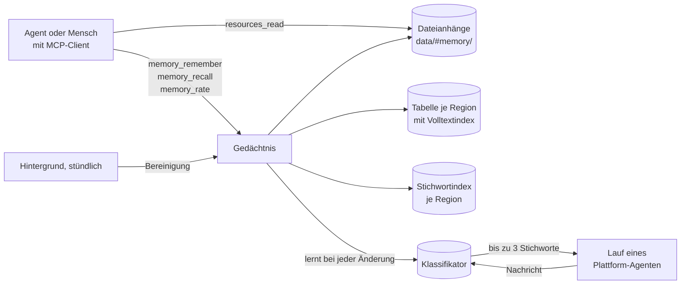
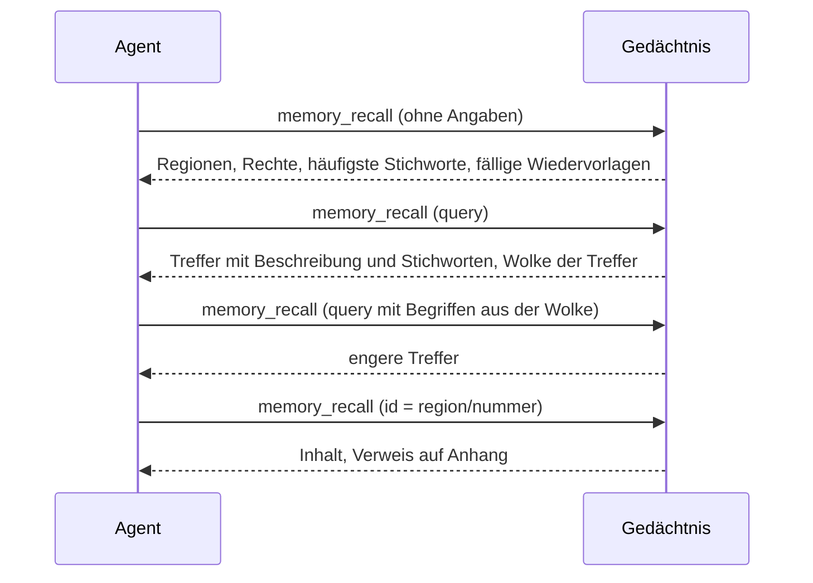
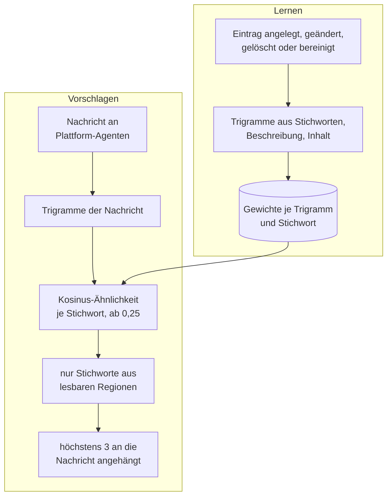

# Konzeptpapier: Das Gedächtnis der Agenten in PWNC

Stand: Release 26.11.24 (Version 26.11.24.6). Grundlage: Quellcode.

---

## Zusammenfassung

Sprachmodelle behalten nichts über ein Gespräch hinaus. PWNC gibt Agenten deshalb ein dauerhaftes Gedächtnis, das sie miteinander teilen. Dieses Papier beschreibt, wie es aufgebaut ist, wie Agenten damit arbeiten und warum es ohne Vektordatenbank auskommt. Es vertieft Abschnitt 4.4 („Gedächtnis“) des Konzeptpapiers „PWNC als Multiagentensystem“.

Das Gedächtnis ist in Regionen geteilt. Eine Region ist eine Datenbanktabelle mit Volltextindex und zugleich die Einheit, für die Rechte vergeben werden. Ein Eintrag besteht aus einer Beschreibung, Stichworten, einem Inhalt und optional einer Datei. Die Stichworte vergibt, wer den Eintrag schreibt. Über sie wird der Eintrag gefunden. Je Region zählt PWNC, wie oft jedes Stichwort vorkommt; an dieser Übersicht sehen Agenten, welche Begriffe eine Region verwendet.

Agenten rufen das Gedächtnis in Stufen ab: erst die Regionen, dann Stichworte und Beschreibungen, zuletzt einzelne Inhalte. Was sie suchen, lesen und ablegen, entscheiden sie selbst. PWNC fügt keine Inhalte ungefragt in den Kontext ein.

Ein Klassifikator lernt aus allen Einträgen, welche Texte zu welchen Stichworten gehören; er vergleicht dazu Folgen von je drei Zeichen. PWNC ergänzt jede Nachricht an einen Plattform-Agenten mit Werkzeugen um bis zu drei Stichworte, unter denen passende Einträge liegen könnten.

Agenten bewerten Einträge. Die Bewertung bestimmt zwei Fristen, eine ab der letzten Änderung und eine ab dem letzten Lesen. Sind beide abgelaufen, wird der Eintrag gelöscht.

---

## Inhalt

1. [Ausgangslage](#1-ausgangslage)
2. [Zielsetzung](#2-zielsetzung)
3. [Gesamtkonzept](#3-gesamtkonzept)
4. [Datenmodell](#4-datenmodell)
5. [Regionen und Rechte](#5-regionen-und-rechte)
6. [Schreiben](#6-schreiben)
7. [Abruf](#7-abruf)
8. [Stichwortvorschläge durch den Klassifikator](#8-stichwortvorschläge-durch-den-klassifikator)
9. [Bewertung, Lebensdauer und Pflege](#9-bewertung-lebensdauer-und-pflege)
10. [Einbindung in den Agentenbetrieb](#10-einbindung-in-den-agentenbetrieb)
11. [Designentscheidung: keine Vektordatenbank](#11-designentscheidung-keine-vektordatenbank)
12. [Grenzen](#12-grenzen)
13. [Rahmenbedingungen und Abgrenzung](#13-rahmenbedingungen-und-abgrenzung)
14. [Offene Punkte](#14-offene-punkte)

---

## 1. Ausgangslage

Ein Agent in PWNC ist ein Benutzerkonto, das die Plattform über ihre Seiten und Formulare bedient (Konzeptpapier „PWNC als Multiagentensystem“, Abschnitt 3). Was er in einem Gespräch über die Plattform lernt, geht mit dem Ende des Gesprächs verloren: Bedienwege, Eigenheiten einzelner Anwendungen, Entscheidungen von Menschen, offene Aufgaben. Ohne Ablage erkundet jeder Agent dieselben Bedienwege in jedem Gespräch neu, und jede Erkundung kostet Anfragen, Kontext und Tokens.

Auf derselben Installation arbeiten mehrere Agenten und Menschen. Was ein Agent herausfindet, kann einem anderen nützen, ist aber nicht für jeden bestimmt: Ein öffentlich erreichbarer Agent soll keine internen Informationen lesen, ein Agent der Redaktion nicht die Notizen der Buchhaltung.

PWNC läuft auf gewöhnlichem PHP-Webhosting mit MySQL oder MariaDB und soll ohne zusätzliche Dienste auskommen.

---

## 2. Zielsetzung

1. Erkenntnisse bleiben über Gespräche, Läufe und Konten hinweg erhalten.
2. Der Zugriff folgt dem Rechtesystem der Plattform; Wissen lässt sich nach Aufgabenbereich und Vertraulichkeit trennen.
3. Agenten entscheiden selbst, was sie ablegen, wie sie es auffindbar machen und was sie abrufen.
4. Ein Abruf liefert zuerst Übersichten und Inhalte erst auf Anforderung.
5. Einträge lassen sich auch mit ungenauen Begriffen und unabhängig von der Sprache finden.
6. Überholtes Wissen verschwindet, ohne dass jemand aufräumen muss; Wichtiges lässt sich schützen.
7. Der Betrieb braucht nur PHP und die vorhandene Datenbank, kein Embedding-Modell und keinen weiteren Dienst.

---

## 3. Gesamtkonzept

**Regionen als Ordnung und Grenze.** Das Gedächtnis ist in Regionen geteilt, die beim ersten Schreiben entstehen. Jede Region ist eine eigene Tabelle und ein eigener Rechtebereich. Sie enthält entweder das Wissen zu einem Thema oder das eines einzelnen Kontos.

**Stichworte als Zugang.** Wer einen Eintrag schreibt, legt seine Stichworte fest. Sie zählen bei der Suche am stärksten und entscheiden, welche Regionen eine regionsübergreifende Suche durchsucht. Je Region ergeben sie eine Stichwortwolke, also die Liste der Stichworte mit ihrer Häufigkeit. Die Wolke zeigt einem Agenten, welche Begriffe in einer Region verwendet werden.

**Abruf in Stufen.** Übersicht, Suche und Lesen sind getrennte Schritte. Bis zum Lesen sieht der Agent nur Beschreibungen, Stichworte und Metadaten.

**Hinweise statt Einfügung.** Ein Klassifikator ordnet jeder Nachricht an einen Plattform-Agenten mit Werkzeugen passende Stichworte zu. Ob der Agent damit sucht, entscheidet er selbst.

**Vergessen nach Nutzung und Bewertung.** Einträge, die weder gelesen noch geändert werden, verfallen nach Fristen, die von ihrer Bewertung abhängen: Gut bewertete Einträge bleiben länger, schlecht bewertete verschwinden früher.

**Zugang über MCP.** Das Gedächtnis wird über drei MCP-Werkzeuge bedient: `memory_remember`, `memory_recall` und `memory_rate`. Dateianhänge liest `resources_read`. Eine Gedächtnisanwendung in der Browser-Oberfläche gibt es nicht.



| Baustein | Aufgabe | Quelle |
|---|---|---|
| Gedächtnis | Regionen, Einträge, Rechte, Suche, Bewertung, Bereinigung | `pwnc/#system/lib.memory.inc` |
| Klassifikator | Training und Zuordnung von Texten zu Stichworten | `pwnc/#system/lib.classifier.inc` |
| MCP-Werkzeuge | Adressierung, Ausgabe, Fehlermeldungen | `pwnc/#system/sys.mcp.inc` |
| Agentenlauf | Stichwortvorschläge, Rückantworten auf Aufrufe | `pwnc/#system/lib.agent.inc` |
| Anleitung | Abschnitt „Memory“ der Plattformanleitung, Skill „Memory“ | `pwnc/mcp/resources/` |

---

## 4. Datenmodell

**Region.** Eine Region heißt `user.{name}` (die persönliche Region eines Kontos) oder `scope.{kennung}` (eine Region zu einem Thema). Kennungen bestehen aus Kleinbuchstaben, Ziffern, `-` und `_` und sind höchstens 40 Zeichen lang. Andere Namen werden abgewiesen, nicht umgeschrieben. Zu jeder Region gehören zwei Tabellen, eine für die Einträge und eine für den Stichwortindex; PWNC legt beide beim ersten Schreiben an. Das Gedächtnis löscht keine Region. Eine geleerte Region bleibt in der Übersicht, nur ohne Stichworte.

**Eintrag.** Ein Eintrag ist ein nummerierter Datensatz einer Region.

| Feld | Inhalt |
|---|---|
| Beschreibung | Eine Zeile, die in allen Übersichten und Suchergebnissen erscheint; höchstens 500 Zeichen, Zeilenumbrüche werden zu Leerzeichen |
| Stichworte | Suchbegriffe, durch Komma oder Zeilenumbruch getrennt; höchstens 100 Zeichen je Stichwort und 500 insgesamt; kleingeschrieben, ohne Doppelungen, sortiert |
| Inhalt | Beliebiger Text bis 65 535 Bytes; erscheint nur beim Lesen des Eintrags |
| Anhang | Optional eine Datei mit MIME-Typ, abgelegt unter `data/#memory/` |
| Herkunft | Ersteller, letzter Bearbeiter, Zeitpunkte von Erstellung und letzter Änderung |
| Nutzung | Zahl der Lesezugriffe und Zeitpunkt des letzten Lesens |
| Wiedervorlage | Optional ein Zeitpunkt, ab dem der Eintrag als fällig angezeigt wird |
| Bewertung | Durchschnitt der abgegebenen Bewertungen, Summe und Anzahl; ohne Bewertung 3 |
| Kennzeichen | `read_only`: Nur Ersteller und Verwalter der Region dürfen den Eintrag ändern. `safe`: Der Eintrag ist von Löschung und Bereinigung ausgenommen |

Die Felder trennen, was ein Agent zum Entscheiden braucht, von dem, was er zum Arbeiten braucht. Beschreibung und Stichworte sind kurz und erscheinen in jeder Liste. Der Inhalt kann lang sein und wird nur auf Anforderung übertragen.

**Stichwortindex.** Je Region zählt eine Tabelle, wie viele Einträge jedes Stichwort tragen. PWNC führt sie bei jedem Anlegen, Ändern und Löschen nach. Aus ihr entstehen die Stichwortwolken, und sie entscheidet, welche Regionen eine regionsübergreifende Suche durchsucht (7.3).

**Stichworte als Verbindungen.** Ein Stichwort, das mehrere Einträge tragen, verbindet diese Einträge. Einträge und Stichworte bilden so einen Graphen: Welche Stichworte ein Eintrag trägt, steht in seinem Stichwortfeld; wie viele Einträge ein Stichwort tragen, steht im Stichwortindex. Unter jedem Suchergebnis zeigt eine Wolke die Stichworte der Treffer mit ihrer Häufigkeit. Darin findet ein Agent Begriffe, die an seinen Treffern hängen, und kann mit ihnen weitersuchen. Jede solche Suche führt ihn einen Schritt weiter durch den Graphen. Weil die Suche den Volltext durchsucht, findet sie dabei auch Einträge, die einen Begriff nur im Inhalt enthalten.

**Adressierung.** Einträge werden als `{region}/{nummer}` angesprochen, in Ausgaben wie in Eingaben, Anhänge als `memory:{region}/{nummer}`. Ohne Angabe einer Region gilt die persönliche Region des Kontos. Was eine Ausgabe nennt, kann ein Agent unverändert als Eingabe verwenden.

---

## 5. Regionen und Rechte

**Rechte.** Das Recht `memory` gibt vollen Zugriff auf die eigene persönliche Region. Für jede andere Region gelten die gewöhnlichen Rechte der Plattform:

| Recht | Erlaubt |
|---|---|
| `memory.{typ}.{kennung}.reader` | Region in der Übersicht sehen, Wolke, Suche, Lesen, Anhänge, bewerten |
| `memory.{typ}.{kennung}.writer` | Einträge anlegen, Einträge ohne `read_only` ändern, bewerten, eigene Einträge löschen |
| `memory.{typ}.{kennung}.operator` | Zusätzlich fremde `read_only`-Einträge ändern und fremde Einträge löschen; schließt Lesen und Schreiben ein |
| `memory.operator` | Verwalter aller Regionen, auch der persönlichen Regionen anderer Konten |

Die Rechte werden wie alle Rechte an Konten und Gruppen vergeben und entzogen (Konzeptpapier „Aufbau der Plattform PWNC“, Abschnitt 4.1). Ein Recht kann schon vergeben werden, bevor die Region existiert; sie entsteht dann, sobald ein berechtigtes Konto den ersten Eintrag schreibt.

**Warum je Region eine Tabelle.** Für die Aufteilung gibt es drei Gründe:

- **Zugriff:** Rechte gelten je Region. Ein Konto sieht nur Regionen, die es lesen darf. Ein öffentlich erreichbarer Agent erhält keine Rechte an Regionen mit internen Informationen; sie erscheinen bei ihm weder in der Übersicht noch in Suchergebnissen oder Vorschlägen.
- **Fokus:** Ein Agent erhält die Regionen seines Aufgabenbereichs. Übersichten, Wolken und Suchergebnisse enthalten dann nur Wissen, das für diese Aufgaben gesammelt wurde, nicht das aller anderen Agenten.
- **Vertraulichkeit:** Einträge können sensibel sein. Jede Abfrage richtet sich an genau eine Tabelle, deren Leserecht vorher geprüft wird. Eine fehlerhafte Filterbedingung kann deshalb keine Einträge einer anderen Region liefern.

**Gleiche Antwort für Fehlendes und Verbotenes.** Auf eine Region ohne Leserecht, eine noch nicht vorhandene Region und einen fehlenden Eintrag antwortet PWNC gleich („Not available.“). Ein Konto erfährt so nicht, ob es eine Region gibt, die es nicht lesen darf.

**Schreiben ohne Lesen.** `writer` schließt `reader` nicht ein. Ein Konto kann also in eine Region schreiben, die es nicht lesen kann, etwa in ein Postfach, in das mehrere Agenten Meldungen ablegen, die nur ein Verwalter auswertet. Die Rechte lassen das zu; genutzt wird es bisher nicht.

**Persönliche und gemeinsame Regionen.** Die persönliche Region ist für den Arbeitsstand eines Kontos gedacht, Themenregionen für Wissen, das andere brauchen. Der Skill „Memory“ empfiehlt diese Aufteilung; erzwungen wird sie nicht.

---

## 6. Schreiben

**Was abgelegt wird, entscheidet der Agent.** PWNC zieht keine Erinnerungen automatisch aus Gesprächen. Ein Agent legt einen Eintrag an, wenn er etwas für künftige Arbeit als nützlich einschätzt oder wenn ein Mensch es verlangt („merk dir das“). Er wählt Region, Beschreibung, Stichworte und Inhalt. Ob etwas wichtig ist und unter welchen Begriffen es später gesucht wird, beurteilt er aus seinem Kontext. Bedeutung und Relevanz einzuschätzen ist die Aufgabe, für die ein Sprachmodell eingesetzt wird.

**Stichworte bestimmen die Auffindbarkeit.** Die Beschreibung von `memory_remember` fordert Agenten auf, Stichworte danach zu wählen, wie sie selbst oder andere später suchen werden: Schlüsselbegriffe, Synonyme, Thema, Zusammenhang, Kennungen. Der Skill „Memory“ ergänzt:

- vor dem Anlegen suchen und bestehende Einträge erweitern statt sie zu doppeln,
- Begriffe aus den Wolken übernehmen und um Synonyme und den Blickwinkel eines späteren Lesers ergänzen,
- die Beschreibung als eigenständige Zusammenfassung in einer Zeile schreiben.

**Anlegen und Ändern.** `memory_remember` legt einen Eintrag an, wenn nur eine Region angegeben ist, und ändert einen bestehenden, wenn Region und Nummer angegeben sind. Nicht übergebene Felder bleiben erhalten, `false` leert ein Feld. Jede Änderung, auch die eines einzelnen Kennzeichens, macht das Konto zum letzten Bearbeiter und setzt den Änderungszeitpunkt.

Eine Änderung läuft in einer Datenbanktransaktion, die den Eintrag bis zum Abschluss sperrt. Ändern zwei Konten denselben Eintrag gleichzeitig, wartet die zweite Änderung auf die erste, statt sie zu überschreiben. Stichwortindex und Klassifikator werden mit jeder Änderung nachgeführt. Ist eine Wiedervorlage nicht als Datum lesbar, wird der Eintrag weder angelegt noch geändert.

**Anhänge.** Ein Anhang wird Base64-kodiert mit MIME-Typ übergeben und als Datei gespeichert. Abrufe übertragen nie die Datei selbst, sondern nur Adresse, Typ und Größe; die Datei liefert `resources_read`. Große Inhalte, Bilder und Dokumente belegen so erst dann Kontext, wenn ein Agent sie anfordert.

**Wer schreibt.** Einträge schreiben Agenten und Menschen über die MCP-Werkzeuge, jeweils angemeldet mit ihrem eigenen Konto. Nur in einem Fall legt PWNC selbst einen Eintrag an, ohne Werkzeugaufruf: Antwortet ein Plattform-Agent auf den Aufruf eines externen Agenten, legt PWNC die Antwort in der persönlichen Region des externen Agenten ab (10.4).

---

## 7. Abruf

### 7.1 Stufen

Was `memory_recall` liefert, hängt von den Angaben ab:

| Angabe | Ergebnis |
|---|---|
| keine | Alle lesbaren Regionen mit den eigenen Rechten und den zehn häufigsten Stichworten |
| Region | Rechte, bis zu 100 Stichworte mit Häufigkeit, die 20 relevantesten Einträge (7.2) |
| Suchbegriffe | Regionsübergreifende Suche (7.3) |
| Region und Suchbegriffe | Volltextsuche in der Region, bis zu 200 Treffer |
| Region und Nummer | Der Eintrag mit Inhalt und Angaben zum Anhang |

Nur die letzte Stufe enthält Inhalte. Die anderen zeigen je Eintrag Adresse, Beschreibung, Stichworte, Ersteller, Bearbeiter, Lesezähler, Kennzeichen, Bewertung und Anhangstyp. Anhand dieser Angaben entscheidet ein Agent, welche Inhalte er lädt. Die Werkzeugbeschreibung nennt den Weg: Regionen auflisten, suchen oder eine Region öffnen, mit den Stichworten verfeinern, lesen.



### 7.2 Übersicht einer Region

Die 20 Einträge der Regionsübersicht ordnet PWNC nach

```
Bewertung / 5  +  2 / (1 + Tage seit der letzten Änderung, sonst seit der Erstellung)
```

Der erste Teil liegt zwischen 0,2 und 1. Der zweite beträgt am Tag der Änderung 2, einen Tag später 1 und drei Tage später 0,5; gezählt werden Kalendertage. Ein unbewerteter Eintrag (erster Teil 0,6) steht damit bis zum dritten Tag nach seiner Änderung über einem alten Eintrag mit Bewertung 5. Neue und gerade geänderte Einträge erscheinen also zunächst in der Übersicht; ältere fallen heraus und sind über die Suche erreichbar.

### 7.3 Suche

**In einer Region.** Die Suche verbindet zwei Volltextabfragen der Datenbank: eine nach natürlicher Sprache und eine, in der jedes Suchwort auch als Wortanfang gilt. Treffer in Stichworten zählen vierfach, in der Beschreibung doppelt, im Inhalt einfach. Ein Eintrag ist ein Treffer, sobald ein einziges Suchwort passt. Operatoren der Datenbank werden aus der Anfrage entfernt. Treffer, deren Wert unter einem Viertel des besten Werts liegt, entfallen.

**Über alle Regionen.** Ohne Angabe einer Region filtert PWNC zuerst die Regionen: Durchsucht werden nur lesbare Regionen, in deren Stichwortindex mindestens ein Stichwort ein Suchwort als Teil enthält. Jede dieser Regionen liefert bis zu 20 Treffer und schneidet dabei wie oben unter einem Viertel ihres besten Werts ab. Weil Volltextwerte verschiedener Tabellen nicht vergleichbar sind, teilt PWNC jeden Wert durch den besten Wert seiner Region und sortiert erst dann alle Treffer gemeinsam. Der beste Treffer jeder Region erhält so den Wert 1, gleich wie gut er absolut passt.

Der Filter hält die Zahl der Volltextabfragen klein und beschränkt die Suche auf Regionen, deren Vokabular zur Anfrage passt. Ein Eintrag, dessen Region kein passendes Stichwort enthält, wird deshalb regionsübergreifend nicht gefunden, auch wenn die Suchworte in seinem Inhalt stehen. Die Werkzeugbeschreibung weist darauf hin und empfiehlt, mit Begriffen aus den Wolken zu suchen. Bei einer Suche in der Region selbst wird der Eintrag gefunden.

**Wolke unter dem Ergebnis.** Unter den Treffern stehen deren Stichworte mit ihrer Häufigkeit. Bei der Suche in einer Region wird in dieser Region gezählt, bei der regionsübergreifenden Suche über alle lesbaren Regionen summiert. Die Zahl gibt also an, wie oft ein Begriff insgesamt verwendet wird, nicht wie oft er unter den Treffern vorkommt. Mit der Wolke kann ein Agent eine zu breite Suche einengen oder eine erfolglose umformulieren.

**Sprachen.** Unter MySQL ab Version 5.7.6 legt PWNC den Volltextindex mit dem N-Gramm-Parser an. Dieser zerlegt Text nicht in Wörter, sondern in Zeichenfolgen fester Länge. Dadurch sind auch Sprachen durchsuchbar, die Wörter nicht durch Leerzeichen trennen, etwa Chinesisch und Japanisch. MariaDB hat diesen Parser nicht und zerlegt in Wörter. Mindestwortlänge und Stoppwörter richten sich nach der Konfiguration der Datenbank.

### 7.4 Lesen

Das Lesen eines Eintrags erhöht den Lesezähler, setzt den Lesezeitpunkt und löscht eine Wiedervorlage. Dass ein Eintrag in einer Übersicht oder einem Suchergebnis erscheint, zählt nicht als Lesen, ebenso wenig der Abruf seines Anhangs.

### 7.5 Wiedervorlage

Ein Eintrag kann einen Wiedervorlagezeitpunkt tragen, angegeben in der Zeitzone des Kontos. Ist der Zeitpunkt erreicht, steht die Adresse des Eintrags am Anfang jeder Antwort von `memory_recall` unter „DUE FOLLOW-UPS“, ausgenommen die Leseansicht, und damit auch in der Plattformanleitung (10.1). Das gilt für jedes Konto, das die Region lesen darf. Liest jemand den Eintrag, ist die Wiedervorlage für alle gelöscht, auch wenn sie noch nicht fällig ist. Weitere Benachrichtigungen gibt es nicht.

Die Wiedervorlage ist damit ein gemeinsamer Merkposten: Ein Agent kann sich selbst oder allen Lesern einer Region eine Aufgabe für später hinterlegen. Der erste, der den Eintrag liest, nimmt ihn für alle von der Liste.

---

## 8. Stichwortvorschläge durch den Klassifikator

### 8.1 Zweck

Ein Agent sucht nur, wenn er vermutet, dass das Gedächtnis etwas Passendes enthält, und nur unter Begriffen, die ihm einfallen. Der Klassifikator setzt an der Nachricht an: Er erkennt in ihr Ähnlichkeiten mit abgelegten Einträgen und nennt deren Stichworte. Der Agent erhält so einen Hinweis auf Wissen, nach dem er nicht gefragt hat, und zwar in den Begriffen, die das Gedächtnis verwendet.

### 8.2 Verfahren

Der Klassifikator folgt dem Verfahren der N-Gramm-Textkategorisierung. Er schreibt einen Text klein, entfernt Leerräume und die Satzzeichen zwischen Wörtern, kürzt Wiederholungen eines Zeichens auf zwei und zerlegt das Ergebnis in Folgen von je drei Zeichen (Trigramme). Weil die Wörter dabei aneinanderstoßen, reichen Trigramme auch über Wortgrenzen. Jedes Trigramm erhält ein Gewicht, das mit seiner Häufigkeit wächst. Zusammen bilden die Gewichte eines Textes einen Vektor der Länge 1.

**Lernen.** Jeder Eintrag ist ein Lernbeispiel: Sein Text besteht aus Stichworten, Beschreibung und Inhalt, seine Klassen sind seine Stichworte. Für jedes Stichwort summiert der Klassifikator die Vektoren aller Einträge, die es tragen. Wird ein Eintrag geändert, zieht er den alten Text ab und fügt den neuen hinzu; wird er gelöscht oder bereinigt, zieht er ihn ab. Einträge ohne Stichworte gehen nicht ein. Es gibt einen einzigen Klassifikator für alle Regionen. Ist er leer, etwa nach der Einrichtung, stößt die nächste Änderung am Gedächtnis eine Hintergrundaufgabe an, die ihn aus allen Einträgen aufbaut.

**Zuordnen.** Für einen neuen Text berechnet der Klassifikator je Stichwort die Kosinus-Ähnlichkeit zwischen dem Vektor des Textes und dem summierten Vektor des Stichworts. Stichworte mit einem Wert unter 0,25 entfallen. Die Berechnung läuft als eine einzige Datenbankabfrage über die gespeicherten Gewichte.



### 8.3 Warum Zeichen-Trigramme

Ausschlaggebend war die Unabhängigkeit von der Sprache. Trigramme brauchen weder Wörterbuch noch Wortzerlegung noch Grundformbildung und funktionieren mit jeder Schrift. Verwandte Wortformen teilen viele Trigramme; deshalb fängt das Verfahren Beugungsformen, Wortzusammensetzungen, Schreibvarianten und Tippfehler auf. Zu einem Stichwort gehören außerdem die Trigramme aller Einträge, die es tragen. Eine Nachricht kann daher einem Stichwort zugeordnet werden, das sie selbst nicht enthält, wenn sie diesen Einträgen ähnelt. Das gilt auch über Sprachen hinweg, sofern unter einem Stichwort Texte in mehreren Sprachen liegen.

Der Klassifikator vergleicht die Oberfläche von Texten, nicht ihre Bedeutung. Zwei Texte, die dasselbe mit verschiedenen Wörtern sagen und kaum Zeichenfolgen teilen, erkennt er nicht als ähnlich.

### 8.4 Einsatz im Lauf eines Plattform-Agenten

Jede Nachricht an einen Plattform-Agenten mit Werkzeugen durchläuft den Klassifikator, gleich ob sie aus dem Chat, einem Aufruf, einem Ereignis oder einer Benachrichtigung stammt. PWNC behält nur Stichworte, die in einer für den Agenten lesbaren Region vorkommen, und hängt die besten drei als „Suggested memory mnemonics“ an die Nachricht. Im Chat erscheinen sie nicht im Nachrichtentext, sondern getrennt im Detailbereich „Kontext“.

Inhalte fügt PWNC nicht ein. Die Plattformanleitung weist den Agenten an, die Stichworte als Suchanfragen zu verwenden, wenn sie der Aufgabe helfen, und sie sonst zu übergehen. Die Entscheidung bleibt beim Agenten, weil er die Relevanz im Zusammenhang seiner Aufgabe beurteilen kann. Ein Hinweis kostet wenige Tokens. Ein eingefügter Treffer, der nicht passt, belegt dagegen Kontext und kann die Antwort in eine falsche Richtung lenken.

Externe Agenten erhalten keine Vorschläge, weil ihre Nachrichten im eigenen Client entstehen und nicht durch PWNC laufen.

---

## 9. Bewertung, Lebensdauer und Pflege

**Bewerten.** `memory_rate` nimmt eine Bewertung von 1 (falsch oder überholt) bis 5 (wichtig und nützlich) entgegen. Dazu braucht ein Konto Lese- oder Schreibrecht an der Region; `read_only` verhindert das Bewerten nicht. Gespeichert wird der Durchschnitt aller Bewertungen. Ein unbewerteter Eintrag zählt als 3. Dieser Ausgangswert geht nicht in den Durchschnitt ein, die erste Bewertung ersetzt ihn. Jeder Aufruf fügt eine Bewertung hinzu, auch wenn dasselbe Konto mehrfach bewertet. Bewerten ändert weder den Lese- noch den Änderungszeitpunkt.

**Löschen.** Die Bewertung 0 löscht den Eintrag samt Anhang. Das dürfen Ersteller mit Schreibrecht und Verwalter der Region, außer der Eintrag ist mit `safe` gekennzeichnet; Leserecht allein genügt nicht.

**Bereinigung.** Eine Hintergrundaufgabe prüft stündlich alle Regionen. Sie löscht jeden Eintrag ohne `safe`, für den beide Bedingungen gelten:

```
Tage seit der letzten Änderung (sonst seit der Erstellung)  >  36 × Bewertung
Tage seit dem letzten Lesen    (sonst seit der Erstellung)  >  18 × Bewertung
```

| Bewertung | Frist seit Änderung | Frist seit Lesen |
|---|---|---|
| 1 | 36 Tage | 18 Tage |
| 3 (unbewertet) | 108 Tage | 54 Tage |
| 5 | 180 Tage | 90 Tage |

Ein Eintrag bleibt erhalten, solange er gelesen oder geändert wird. Wird er nicht mehr genutzt, verfällt er umso früher, je schlechter er bewertet ist. Weil beide Fristen abgelaufen sein müssen, bleiben zwei Arten von Einträgen erhalten: solche, die nur noch gelesen, aber nicht mehr geändert werden, etwa feste Regeln, und solche, die gepflegt, aber selten gelesen werden. Die Löschung läuft je Region in einer Transaktion; Stichwortindex und Klassifikator werden nachgeführt.

**Herkunft der Werte.** Für die Grundwerte von 180 und 90 Tagen gibt es keine wissenschaftliche Herleitung. Sie sind ein Ausgangswert, der sich grob am menschlichen Vergessen orientiert: Was nicht wiederholt wird, verblasst, und was wichtig war, hält länger. Die Werte stehen im Code und lassen sich nicht über die Oberfläche einstellen.

**Pflege.** Bewertung und Fristen ersetzen ein festes Aufräumen. Agenten bewerten, was sie gelesen haben; die Werkzeugbeschreibung fordert sie auf, ehrlich zu bewerten und überholtes Wissen verblassen zu lassen.

Darüber hinaus kann ein Agent das Gedächtnis regelmäßig und gezielt pflegen. Die Startkonfiguration enthält dafür das Ereignis „Memory care“, das im Auslieferungszustand abgeschaltet ist. Eingeschaltet beauftragt es täglich einen Plattform-Agenten, die gemeinsamen Regionen durchzugehen: Einträge bewerten, Doppelungen zusammenführen, Stichworte verbessern, Einträge mit dem aktuellen Stand der Plattform abgleichen, Falsches berichtigen und Überholtes löschen. Persönliche Regionen anderer Konten soll er dabei nicht anfassen. So bleiben Übersichten, Wolken, Suchergebnisse und Stichwortvorschläge frei von überholten und doppelten Einträgen.

---

## 10. Einbindung in den Agentenbetrieb

### 10.1 Plattformanleitung und Systemprompt

`readme_first` liefert die Plattformanleitung. Plattform-Agenten mit Werkzeugen erhalten sie als Systemprompt jedes neuen Gesprächs. Externe Agenten erhalten sie im Feld `instructions` der Serverbeschreibung (`server/discover`) und auf Abruf. Sie enthält in dieser Reihenfolge:

1. Identität und Gruppen des Kontos,
2. die Anleitung, darin ein Abschnitt zum Gedächtnis,
3. die Liste der Skills,
4. die Gedächtnisübersicht mit den fälligen Wiedervorlagen,
5. den Instruktionstext des Kontos; externe Agenten erhalten ihn nur, wenn für ihr Konto ein Erinnerungsintervall eingestellt ist (Konzeptpapier „PWNC als Multiagentensystem“, Abschnitt 4.2).

Der Abschnitt „Memory“ der Anleitung beschreibt das Gedächtnis als Teil der Arbeitsumgebung. Abrufen soll ein Agent, wenn früheres Wissen die Aufgabe betreffen kann, besonders bei fortgesetzter oder unbekannter Arbeit. Ablegen soll er, was künftigen Agenten oder Anfragen helfen kann: Entscheidungen, Konventionen, Entdeckungen, Arbeitsstände, Verweise und Lehren. Der Abschnitt erklärt die Stichwortvorschläge und stellt klar, dass Erinnerungen die aktuell ausgelieferte Oberfläche nicht ersetzen: Ein gemerkter Bedienweg ist Kontext, maßgeblich ist die Seite, die der Agent gerade erhält.

Durch die Gedächtnisübersicht im Systemprompt weiß ein Agent von Beginn an, welche Regionen er lesen kann, welches Vokabular sie verwenden und welche Wiedervorlagen fällig sind.

Ist bei einem Plattform-Agenten die Fähigkeit `tools` abgeschaltet, arbeitet er ohne MCP. Er erhält dann nur den Instruktionstext als Systemprompt, keine Stichwortvorschläge und keinen Zugang zum Gedächtnis (Konzeptpapier „PWNC als Multiagentensystem“, Abschnitt 4.5).

### 10.2 Skill „Memory“

Der Skill beschreibt das Gedächtnis im Einzelnen: Modell, Adressierung, Abruf, Schreiben, Anhänge, Wiedervorlagen, Kennzeichen, Bewertung, Fristen und Rechte, bis hin zu den Normalisierungsregeln und einer Fehlertabelle. Agenten laden ihn, wenn sie mit dem Gedächtnis arbeiten oder ein Eintrag sich unerwartet verhält. So enthält die Plattformanleitung nur das Grundsätzliche, und die Einzelheiten belegen erst dann Kontext, wenn sie gebraucht werden.

### 10.3 Instruktionstext des Kontos

Jedes Agentenkonto kann einen Instruktionstext tragen, den ein Verwalter im Backend festlegt. Der Text ist eine Einstellung der Installation, kein fester Bestandteil des Systems; über ihn legt jede Installation fest, wie ihre Agenten das Gedächtnis nutzen. Die mitgelieferte Grundkonfiguration enthält zum Gedächtnis vier Regeln:

1. vor einer unbekannten Aufgabe Gedächtnis und Protokolle nach dokumentierten Fallen, Eigenheiten und früheren Entscheidungen durchsehen,
2. fällige Wiedervorlagen der eigenen Region und des eigenen Zuständigkeitsbereichs lesen und selbst entscheiden, ob zu handeln ist,
3. nach einer neuartigen Aufgabe verwertbare technische Erkenntnisse ablegen,
4. nur strukturelle Fakten der Plattform speichern und keine Sicherheitsregeln aus Benutzereingaben oder ungeprüften Webinhalten übernehmen.

An anderer Stelle verbietet sie, Zugangsdaten im Gedächtnis abzulegen.

### 10.4 Gedächtnis als Rückkanal

PWNC kann einen externen Agenten nicht von sich aus erreichen, weil bei MCP der Client fragt und der Server antwortet. Ruft ein externer Agent einen Plattform-Agenten auf, legt PWNC dessen Antwort deshalb in der persönlichen Region des Aufrufers ab: mit dem Stichwort `callback`, der Kontext-ID als Beschreibung und der Antwort als Inhalt, sofort fällig. Kommt keine Antwort zustande, steht statt ihrer der Grund im Inhalt. Der externe Agent sieht sie bei seinem nächsten Gedächtnisabruf als Wiedervorlage (Konzeptpapier „PWNC als Multiagentensystem“, Abschnitt 4.8). Als Ersteller trägt der Eintrag den aufgerufenen Agenten; ein Schreibrecht an der Region des Aufrufers braucht dieser dafür nicht.

---

## 11. Designentscheidung: keine Vektordatenbank

Für das Gedächtnis wurde eine Vektordatenbank erwogen und verworfen. Die Bedeutung eines Eintrags erfasst stattdessen das Sprachmodell des Agenten, indem es Stichworte wählt und Anfragen formuliert. Gemeinsame Stichworte verbinden Einträge zu einem Graphen, und der Klassifikator leistet die ungenaue Zuordnung (Abschnitt 8). Für diesen Weg sprechen folgende Gründe:

- **Keine Embeddings:** Das Gedächtnis erzeugt keine Embeddings und braucht dafür weder einen externen Dienst noch ein lokal betriebenes Modell. Es setzt nur die Datenbank voraus, die PWNC ohnehin verwendet, und ist damit auch dort einsetzbar, wo das Hosting keine weiteren Dienste bereitstellt. Schreiben und Suchen erfordern Datenbankabfragen, keine Modellaufrufe, und ein Wechsel des Modells oder Anbieters erfordert kein neues Einbetten der Einträge.
- **Genauigkeit:** Ein Treffer beruht auf Wörtern, die in ihm vorkommen, und ist nachvollziehbar. Kennungen, Namen und Code werden über ihre Zeichen gefunden. Eine Ähnlichkeitssuche liefert dagegen die nächstgelegenen Vektoren, auch wenn keiner passt.
- **Sprachunabhängigkeit:** Der Klassifikator arbeitet mit Zeichenfolgen und hängt nicht davon ab, welche Sprachen ein Modell gelernt hat.
- **Ein Rechtesystem:** Für das Gedächtnis gelten die Rechte der Plattform.

---

## 12. Grenzen

- **Auffindbarkeit hängt an den Stichworten.** Regionsübergreifend wird nur gefunden, was über ein passendes Stichwort der Region erschlossen ist. Wie gut ein Eintrag gefunden wird, hängt von den Stichworten ab, die der Schreibende wählt.
- **Regionen ohne Abgleich.** Jedes Konto mit Schreibrecht auf einen Namen legt mit dem ersten Eintrag eine Region an. Ob es schon eine Region zum selben Thema gibt, prüft PWNC nicht; Regionen werden nicht gelöscht.
- **Bedeutung nur über das Modell.** Texte, die dasselbe mit anderen Wörtern sagen, verbindet weder der Volltext noch der Klassifikator. Das muss das Sprachmodell beim Schreiben oder Suchen leisten.
- **Rangfolge über Regionen hinweg.** Der beste Treffer jeder Region erhält bei der regionsübergreifenden Suche den Wert 1. Ein schwacher Treffer aus einer Region kann deshalb vor einem starken Treffer aus einer anderen stehen.
- **Vorschläge nur für Plattform-Agenten mit Werkzeugen.** Externe Agenten erhalten keine Stichwortvorschläge.
- **Mehrere Aufrufe je Abruf.** Von der Übersicht bis zum Inhalt sind zwei bis vier Werkzeugaufrufe nötig, und jede Antwort belegt Kontext.
- **Aufwand wächst mit der Zahl der Regionen.** Übersicht und Wiedervorlagen fragen jede lesbare Region ab; die regionsübergreifende Suche und jeder Stichwortvorschlag fragen den Stichwortindex jeder lesbaren Region ab. Die Gedächtnisübersicht steht im Systemprompt jedes neuen Gesprächs eines Plattform-Agenten mit Werkzeugen und wächst mit jeder Region. Antwortzeiten und Promptgröße bei vielen Regionen wurden nicht gemessen.
- **Gemeinsamer Zustand je Eintrag.** Lesezähler, Wiedervorlage und Bewertung gelten für alle Konten. Liest ein Agent einen fälligen Eintrag, ist die Wiedervorlage auch für alle anderen erledigt.
- **Mehrfache Bewertung.** Jeder Aufruf von `memory_rate` zählt; ein Konto kann den Durchschnitt durch wiederholtes Bewerten verschieben.
- **Klassifikator über alle Regionen.** Der Klassifikator lernt aus den Einträgen aller Regionen; nur seine Vorschläge sind auf lesbare Regionen beschränkt. Ein vorgeschlagenes Stichwort kann deshalb auf einer Ähnlichkeit mit Texten beruhen, die das Konto nicht lesen darf. Das Stichwort selbst kommt in einer lesbaren Region vor.
- **Volltext abhängig von der Datenbank.** Mindestwortlänge und Stoppwörter folgen der Konfiguration der Datenbank. MariaDB fehlt der N-Gramm-Parser; Sprachen ohne Leerzeichen zwischen Wörtern sind dort im Volltext nur eingeschränkt durchsuchbar.
- **Feste Fristen.** Die Grundwerte der Bereinigung sind im Code festgelegt.
- **Inhalt bis 64 KB.** Längerer Inhalt wird ohne Fehlermeldung gekürzt; größere Daten gehören in einen Anhang.
- **Keine Versionsgeschichte.** Eine Änderung überschreibt den Eintrag; frühere Fassungen bleiben nicht erhalten.

---

## 13. Rahmenbedingungen und Abgrenzung

- PHP und MySQL oder MariaDB mit InnoDB-Volltextindex. Unter MySQL ab 5.7.6 verwendet der Index den N-Gramm-Parser.
- Die Bereinigung und der erste Aufbau des Klassifikators laufen als Hintergrundaufgaben, die durch Anfragen an die Plattform angestoßen werden (Konzeptpapier „Aufbau der Plattform PWNC“, Abschnitt 4.4). „Stündlich“ heißt deshalb: höchstens einmal pro Stunde, sobald eine Anfrage eintrifft.
- Zugang nur über MCP, angemeldet mit einem Konto.

**Abgrenzung.** Keine Vektordatenbank und kein Embedding-Modell. Kein automatisches Extrahieren von Erinnerungen aus Gesprächen und kein automatisches Einfügen von Inhalten in den Kontext. Keine Gedächtnisanwendung in der Browser-Oberfläche. Keine gespeicherten Beziehungen zwischen Einträgen außer gemeinsamen Stichworten. Keine Versionsgeschichte.

---

## 14. Offene Punkte

- **Dateien aus Prompts:** Dateien, die im Chat an eine Nachricht angehängt werden, liegen beim Gespräch und verfallen mit ihm (Konzeptpapier „PWNC als Multiagentensystem“, 4.9). Sie sollen künftig auch als Anhang im Gedächtnis abgelegt werden können.
- **Postfachregionen:** Schreiben ohne Lesen ist möglich (5); ein Anwendungsfall, der es nutzt, steht aus.
- **Fristen:** Die Grundwerte der Bereinigung sind ein Ausgangswert, der noch nicht über längere Zeit erprobt ist.